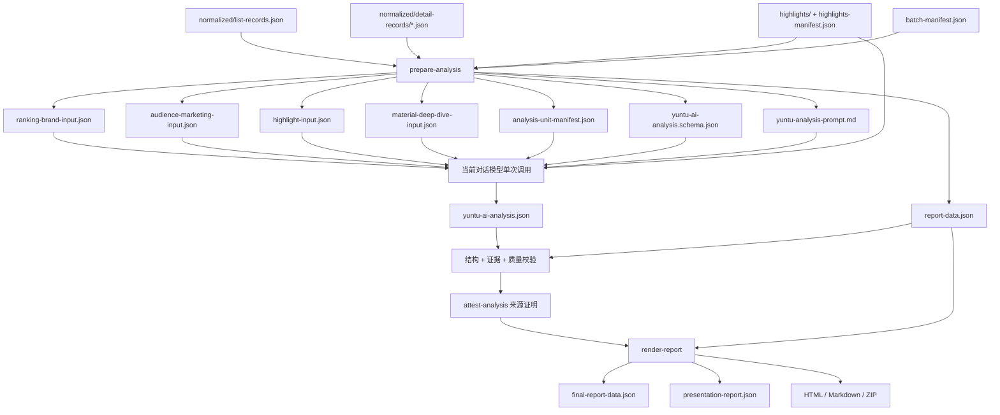

# 云图第二部分数据分析能力优化交接摘要

## 当前结论

云图技能从后处理数据到报告交付的第二部分已经完成一次结构性收敛，可以进入“按章节扩充事实维度与分析能力”的下一阶段。

本轮优化解决的核心问题不是增加模型调用次数，而是建立稳定的章节边界：四个分析单元分别读取自己的事实包，在同一次当前对话模型调用中生成四个顶层分析字段；统一 Schema、证据校验、质量校验、Presentation 投影和报告渲染共同约束最终结果。新批次不再生成冗余的 `yuntu-analysis-data.json`，历史批次仍保留回退渲染能力。

下一阶段建议一次只优化一个章节。任何新增分析内容都不能只修改 Prompt，必须同步检查事实包、输出 Schema、统一校验、Presentation JSON、HTML/Markdown 渲染和测试。

## 当前代码基线

- 仓库：`/Users/shuzida/Desktop/FDE客户/小仙炖/yuntu-industry-content-rankings-analysis`
- 分支：`codex/yuntu-presentation-schema`
- 基线提交：`b304652 精简分析产物，保留历史报告兼容`
- 远端：当前分支已与 `origin/codex/yuntu-presentation-schema` 对齐。
- 工作区：生成本交接文档前为干净状态。
- 自动测试：`python -m unittest discover -s tests -p 'test_*.py'`，216 项通过。

本轮相关提交：

| 提交 | 作用 |
|---|---|
| `6cf7a67` | 删除报告未展示的分析字段，模型输出收敛为四个实际消费模块。 |
| `dad608f` | 生成四个章节事实包、单次调用 manifest、统一 Schema，并强化分析来源证明。 |
| `d7c87f4` | 在 `attest-analysis` 前执行统一结构、证据和质量校验。 |
| `b304652` | 新批次停止写入 `yuntu-analysis-data.json`，保留 `report-data.json` 与历史回退。 |

设计与实施记录：

- `docs/superpowers/specs/2026-08-27-yuntu-analysis-data-retirement-design.md`
- `docs/superpowers/plans/2026-08-27-yuntu-analysis-data-retirement.md`

## 当前处理链路



关键边界：

- `prepare-analysis` 只读取已经后处理完成的 `normalized/`、`highlights/` 和批次 manifest，不重新执行 RPA。
- 四个事实包在一次模型调用中统一读取，不拆成四次模型调用。
- 数据和高光帧理解必须由当前对话模型直接完成；不得通过 `codex exec`、子进程或外部模型服务替代。
- 规则代码只负责统计、归类、聚合、Schema 和校验，不生成程序化业务结论。
- 模型不读取 `report-data.json`，该文件只服务校验、Presentation 和报告渲染。
- 新批次不生成 `yuntu-analysis-data.json`；`render-report` 仅在历史批次缺少 `report-data.json` 时回退读取旧快照。

## 四个分析单元的当前契约

| 分析单元 | 当前事实包 | 当前主要证据维度 | 模型输出 | 报告章节 |
|---|---|---|---|---|
| 榜单品牌 | `ranking-brand-input.json` | 榜单 scope、行业 TOP1000 素材与指标汇总、各品牌 Top N 素材与指标汇总 | `topMaterialCombination` | 01 榜单与品牌分析 |
| 人群卖点 | `audience-marketing-input.json` | `all` 与逐品牌 scope、Top 素材、人群 Dashboard、营销标签 Dashboard | `chapter02Insights` | 02 人群及营销卖点 |
| 视觉高光 | `highlight-input.json` | 秒级详情 scope、成功/失败高光帧、帧引用、秒点、点击指数、本地图片路径 | `highlightDashboard` | 04 视觉高光 |
| 单素材秒级 | `material-deep-dive-input.json` | 单素材指标与行业比较、人群/营销标签、五类秒级趋势、该素材全部高光帧 | `materialDeepDives` | 05 单素材深度分析 |

### 01 榜单品牌

事实包当前包含：

- `reportScope`：榜单样本数、来源、选择规则与限制。
- `industryTop1000Facts`：`sample_count`、`requested_top_n`、指标汇总和素材明细。
- `brandTopNFacts`：每个指定品牌的 Top N 样本、指标汇总和素材明细。
- 素材明细当前包含 `material_id`、排名、标题、指标、人群标签和营销标签。
- 当前用于榜单判断的核心指标是曝光、CTR、CVR 和 3 秒播放率；CPM 未返回时不得推算。

输出当前只允许：

- `executiveSummary`
- `brandConclusions`
- `brandComparisonConclusion`

扩充这一章时，优先判断新增内容属于行业总览、单品牌结论还是跨品牌比较。新增事实不应借用秒级详情或高光帧，除非重新确认章节业务边界。

### 02 人群卖点

事实包当前包含：

- `chapter02AiFacts.scopeOrder`：固定以 `all` 开头，后接用户指定品牌。
- 每个 scope 的 `sampleCount`、`topMaterials`、`audienceDashboard` 和 `marketingDashboard`。
- `audienceDashboard` 包含样本与多个人群维度的标签桶。
- `marketingDashboard` 包含标签总数、命中素材数、Top 标签、标签类别及其素材引用。

输出为每个 scope 的：

- `audienceSummary`
- `audienceInsights`，至少 2 条。
- `marketingSummary`
- `marketingInsights`，至少 2 条。

这一章有明确双事实源：

- `chapter02AiFacts`：模型二次分析唯一来源，品牌 scope 使用用户输入的 Top N。
- `chapter02Facts`：前端汇总图表、范围 Tab 和 Top N 控件的唯一来源，品牌 scope 使用全量匹配素材。

扩充时必须先确定新增维度属于“AI 分析证据”“前端汇总图表”还是两者都需要，避免只扩 `chapter02AiFacts` 导致报告无图，或只扩 `chapter02Facts` 导致模型无法解释。

### 04 视觉高光

事实包当前包含：

- `reportScope`：秒级详情成功、失败和样本范围。
- `visualAssets`：`material_id`、标题、排名、`frame_ref`、秒点、帧类型、峰值排名、点击指数、可用状态、本地图片路径与帧来源。
- `dataLimitations`：失败帧及原因。

当前模型必须实际查看每张 `available=true` 的本地 JPEG，并将每张成功帧恰好一次归入：

- `portrait`
- `product`
- `other`

每组输出 `common_patterns` 与 `derivative_directions`。所有引用必须落在该组 `frame_refs` 内，禁止把画面与点击、转化写成因果关系。

扩充视觉维度时，需要同时判断新增字段是机器事实（例如帧类型、秒点、指标）、模型观察（例如构图、主体、可见字幕）还是前端交互元数据。不要把模型视觉判断预先写成规则代码。

### 05 单素材秒级

事实包当前按素材组织，包含：

- 素材 ID、排名、标题。
- 素材整体指标与 `metricComparison`。
- 人群标签、营销标签。
- `secondLevelBreakdown`：点赞、流失、点击、互动、评论五类趋势及真实秒点。
- `highlightFrameAvailability` 和该素材的全部高光帧。

每条输出当前只允许：

- `material_id`
- `frame_observations`
- `second_level_observations`

每张成功帧必须恰好出现一次；秒级观察的 `evidence_seconds` 必须真实存在于对应趋势点中。当前报告不生成额外的单素材 AI 总结字段。

如果下一阶段要增加单素材结论、结构段落、素材诊断或优化方向，这是一次输出契约和前端布局变化，不能只在 Prompt 中要求模型多写字段。

## 统一输出与校验契约

统一输出文件 `yuntu-ai-analysis.json` 当前最多包含四个顶层字段：

```text
topMaterialCombination
chapter02Insights
highlightDashboard       # 有成功高光帧时必需
materialDeepDives        # 有秒级数据时必需
```

当前门禁分为三层：

1. `yuntu-ai-analysis.schema.json`：字段、类型、枚举、必填项、数量和动态 scope/material ID 范围。
2. `scripts/yuntu_report.py`：素材 ID、帧引用、秒点、scope、覆盖完整性、文本长度、禁用话术和重复内容等证据与质量校验。
3. `scripts/yuntu_analysis_provenance.py`：`attest-analysis` 写来源证明前调用统一验证；未通过验证不能生成有效 provenance。

`render-report` 只消费已经通过验证的模型结果，不负责补写、改写或兜底生成业务结论。

## 报告与前端消费链路

当前没有独立的 `templates/` 目录。报告展示主要由以下文件负责：

| 层 | 文件 | 职责 |
|---|---|---|
| 报告输入验证与编排 | `scripts/yuntu_report.py` | 验证四个模型字段，构造报告数据，生成 Markdown、HTML、Presentation JSON 和 ZIP。 |
| 稳定章节 HTML | `scripts/yuntu_report_sections.py` | 渲染 01、02、04、05 章节的 HTML 结构和交互标记。 |
| 前端展示投影 | `scripts/yuntu_presentation.py` | 把模型分析与 `report-data.json` 投影为稳定的 `presentation-report.json`。 |
| 样式和离线资源 | `assets/report/` | 报告 CSS、JavaScript 与离线展示资源。 |

Presentation 当前固定包含：

- `chapter01`：榜单品牌分析。
- `chapter02`：人群与营销卖点，包含 scope 和图表投影。
- `chapter04`：高光帧分类、共性洞察和裂变方向。
- `chapter05`：素材 Tab、帧观察和秒级趋势观察。

扩充报告展示时，应先修改 `scripts/yuntu_presentation.py` 的章节投影，使前端得到稳定结构，再修改 `scripts/yuntu_report_sections.py` 的 HTML 结构；不要只把新字段直接插入 HTML。若 `presentation-report.json` 结构发生不兼容变化，需要评估并更新 `presentationSchemaVersion`。

## 下一阶段的同步修改矩阵

对任一章节增加数据维度或分析内容时，按以下顺序执行：

| 顺序 | 必查层 | 主要文件 | 必须回答的问题 |
|---|---|---|---|
| 1 | 业务与展示契约 | 新设计文档 | 新字段解决什么决策问题，展示在哪一章，是否需要图表或交互？ |
| 2 | 后处理数据可用性 | `normalized/`、`highlights-manifest.json` 样例 | 原始后处理结果是否真实存在该维度，缺失语义是什么？ |
| 3 | 事实构造 | `scripts/yuntu_analysis.py` | 字段属于哪个事实包，是否需要进入 `report-data.json`，是否破坏章节隔离？ |
| 4 | 模型分析规则 | `prompts/yuntu-analysis-prompt.md` | 模型如何使用新增事实，允许与禁止做出什么判断？ |
| 5 | 输出 Schema | `scripts/yuntu_analysis.py` 的 Schema 构造函数 | 新输出的字段、类型、数量、枚举与动态引用范围是什么？ |
| 6 | 统一校验 | `scripts/yuntu_report.py` | 素材、帧、秒点、scope 如何证实；文本质量和因果边界如何验证？ |
| 7 | 来源门禁 | `scripts/yuntu_analysis_provenance.py` | `attest-analysis` 是否会在写 provenance 前覆盖新增契约？ |
| 8 | Presentation | `scripts/yuntu_presentation.py` | 前端稳定结构、交互和数据源声明如何扩充？ |
| 9 | 报告渲染 | `scripts/yuntu_report_sections.py`、`scripts/yuntu_report.py`、`assets/report/` | HTML、Markdown、导航、响应式布局和 ZIP 是否同步？ |
| 10 | 契约测试 | `tests/test_yuntu_analysis.py`、`tests/test_yuntu_report.py`、`tests/test_yuntu_presentation.py`、`tests/test_rpa_connector.py`、`tests/test_skill_contract.py` | 是否覆盖生成、泄漏边界、Schema、证据错误、质量错误、展示投影和历史兼容？ |
| 11 | 真实回归 | 固定真实批次的临时目录 | 当前对话模型是否读取全部所需证据和图片；结果能否通过 attest 与渲染？ |

## 推荐的单章节实施方式

1. 先选一个章节，不同时扩四包。
2. 列出该章节当前字段、拟新增字段、数据来源、缺失策略和报告展示位置。
3. 先增加失败测试，证明当前事实包或报告不具备该维度。
4. 最小扩充事实包，确认没有带入其他章节的大型展示数据。
5. 同步 Prompt 与统一输出 Schema。
6. 增加证据和质量校验，确保模型不能引用不存在的素材、帧、秒点或 scope。
7. 扩充 Presentation 投影和对应 HTML/Markdown 展示。
8. 用固定 fixture 跑聚焦测试，再跑 216 项以上全量测试、Python 编译和 `git diff --check`。
9. 用同一真实批次在系统临时目录重跑 `prepare-analysis`；由当前对话模型读取新事实包和所有需要的 JPEG，生成新的分析 JSON。
10. 执行 `attest-analysis`、`render-report` 和自动化产物校验，不覆盖原始 RPA 批次。

## 固定真实回归基线

建议继续使用：

`RPA数据汇总/yuntu-rankings-analysis-20260730-20260805-top10`

已验证的 current-dialog 基线：

- 行业 TOP1000：1000 条。
- 指定品牌：小仙炖、五个女博士、燕之屋。
- 秒级深度素材：10 条。
- 可用高光帧：58 张。
- 模型输出顶层字段：4 个。
- `materialDeepDives`：10 条。
- 高光看板主分类引用：58 个，唯一引用 58 个。
- 单素材逐帧观察：58 个，唯一引用 58 个。
- 02 章 scope：`all`、小仙炖、五个女博士、燕之屋。
- 最终报告：4 章、10 条素材、4 个 scope、58 张渲染帧，状态为 `complete`。

旧 current-dialog 产物用于历史比较，其中仍存在 `yuntu-analysis-data.json`。这不代表最新代码还会生成该文件。最新代码已经在全新临时目录证明新批次不落盘完整快照。

当前真实批次文件大小可作为扩维后的输入预算基线：

| 文件 | 字节数 |
|---|---:|
| 历史完整快照 `yuntu-analysis-data.json` | 5,649,775 |
| `ranking-brand-input.json` | 557,256 |
| `audience-marketing-input.json` | 682,450 |
| `highlight-input.json` | 25,160 |
| `material-deep-dive-input.json` | 147,903 |
| 四个模型事实包合计 | 1,412,769 |
| `report-data.json` | 1,266,187 |
| Prompt | 9,692 |
| AI JSON | 47,035 |

扩充某一事实包后，应报告该包扩充前后字节数、四包总字节数和预计输入 Token 变化。不要为了新增少量结论重新把 5.6MB 完整对象传给模型。

## 不可回退的设计原则

- 不恢复四次模型调用；当前目标是一次调用下的章节隔离，不是执行单元并发。
- 不让模型读取 `report-data.json` 或历史完整快照作为业务证据。
- 不把展示专用图表数据无差别复制进模型事实包。
- 不让一个章节借用另一个章节的业务证据；跨章节需求必须先重新定义边界。
- 不增加程序化业务结论或无模型兜底。
- 不只改 Prompt 而不改事实与验证，也不只改前端而不补上游契约。
- 不覆盖原始 `raw-csv/`、`normalized/`、`highlights/` 和历史真实批次。
- 不删除历史 `yuntu-analysis-data.json`；历史兼容只保留在读取侧。
- 不重新拉取 RPA，除非用户明确要求采集新数据。
- 真实视觉分析继续由当前对话模型实际查看所有要求的本地 JPEG。

## 新对话建议先做什么

先只读评估四个事实包，不直接修改 Prompt。建议输出一张“当前维度 -> 缺失业务问题 -> 拟新增事实 -> 拟新增模型输出 -> 报告展示”的差距矩阵，然后由用户选择第一个要优化的章节。

优先级建议：

1. 先优化用户最关心、且后处理数据已经具备证据的章节。
2. 优先扩充事实表达和证据校验，再扩充模型文字长度。
3. 如果新增内容只用于图表，放入 `report-data.json` 和 Presentation，不必传给模型。
4. 如果新增内容要求模型判断，必须进入所属章节包，并同步 Prompt、Schema 和校验。
5. 如果新增内容既要模型判断又要前端图表，分别设计 AI 事实与展示事实，避免混用。

## 新对话启动提示词

```text
继续优化项目：

/Users/shuzida/Desktop/FDE客户/小仙炖/yuntu-industry-content-rankings-analysis

当前分支：
codex/yuntu-presentation-schema

当前基线提交：
b304652 精简分析产物，保留历史报告兼容

先完整阅读交接摘要：
docs/handoffs/2026-08-27-yuntu-analysis-capability-handoff.md

当前已完成：
1. 后处理数据保持不变，prepare-analysis 从 normalized、highlights 和 batch manifest 构造分析输入。
2. 模型输入已拆为榜单品牌、人群卖点、视觉高光、单素材秒级四个章节事实包。
3. 四包由当前对话模型在同一次调用中统一读取，不拆为四次模型调用。
4. 统一输出只包含 topMaterialCombination、chapter02Insights、highlightDashboard、materialDeepDives。
5. attest-analysis 前已经执行结构、证据和质量统一校验。
6. report-data.json 只用于验证、Presentation 和报告渲染，不作为模型证据。
7. 新批次不再生成 yuntu-analysis-data.json；历史批次仍保留回退渲染。
8. 当前全量测试为 216 项并已通过。

本轮目标：
评估并逐章扩充事实包的数据维度、对应分析能力以及前端报告展示。先只选择一个章节实施，不要同时修改四个章节。

要求：
1. 先读取 SKILL.md、交接摘要、prompts/yuntu-analysis-prompt.md、scripts/yuntu_analysis.py、scripts/yuntu_report.py、scripts/yuntu_presentation.py、scripts/yuntu_report_sections.py 和相关测试。
2. 使用真实批次 RPA数据汇总/yuntu-rankings-analysis-20260730-20260805-top10 作为只读基线，不重新拉取 RPA，不覆盖原始产物。
3. 先输出四个事实包当前数据维度和分析缺口矩阵，再建议第一个优化章节，等待我确认章节和业务目标后实施。
4. 对选定章节先定义新增业务问题、事实字段、缺失策略、模型输出字段和报告展示位置。
5. 同步修改所属事实包、Prompt、统一 Schema、证据/质量校验、Presentation 投影、HTML/Markdown 渲染和测试；不能只改其中一层。
6. 保持单次当前对话模型调用；数据和高光帧分析不得交给 codex exec、子进程或外部模型服务。
7. 规则代码不得生成程序化业务结论；模型引用的素材、帧、秒点和 scope 必须可由所属事实包验证。
8. 如果新增维度只用于图表展示，不要传给模型；如果既用于分析又用于展示，分别设计 AI 事实和展示事实。
9. 新增测试必须证明章节隔离、字段投影、Schema、证据校验、质量校验和报告消费均成立。
10. 完成后在系统临时目录用同一真实批次重跑 prepare-analysis，由当前对话模型重新分析所需事实和图片，再执行 attest-analysis 与 render-report。
11. 最终运行全量测试、Python 编译和 git diff --check，并报告事实包字节数与预计 Token 变化。

先做证据驱动的差距分析，不要直接开始编码。
```
