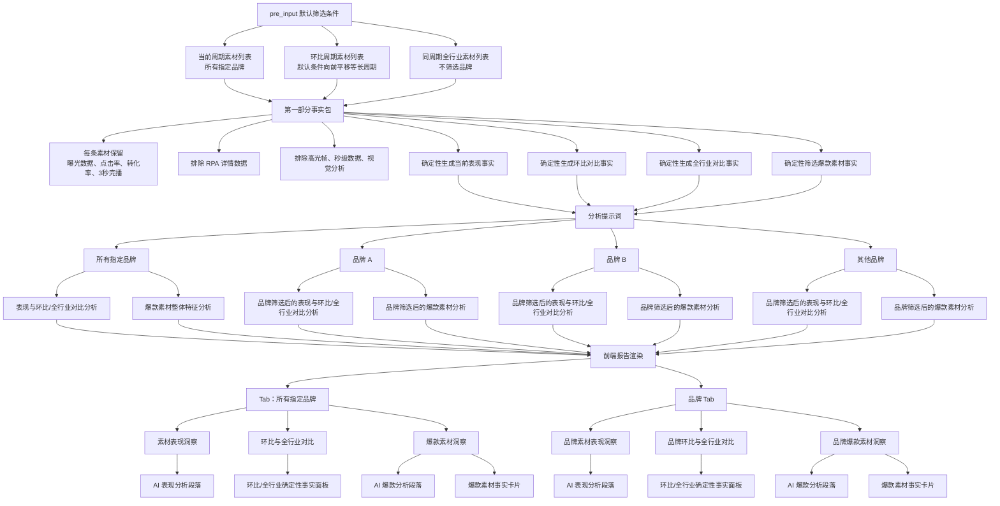

# 第一部分｜素材榜单数据洞察链路

> 本图是第一部分事实包、提示词和前端报告渲染的固定链路基准。

## 范围约束

- 当前列表与环比列表按 `pre_input` 默认筛选条件生成。
- 全行业列表使用相同时间周期，但不再筛选品牌。
- 品牌范围的环比事实按品牌筛选当前列表与环比列表；全行业对比事实始终引用未筛品牌的全行业列表。
- 曝光、点击率、转化率、3 秒完播的聚合、环比变化和行业差异由事实包确定性计算。
- RPA 详情、高光帧、秒级数据和视觉分析不进入第一部分事实包。
- AI 只解释事实包生成的结果，不重新计算指标；爆款清单由确定性事实面板展示。
