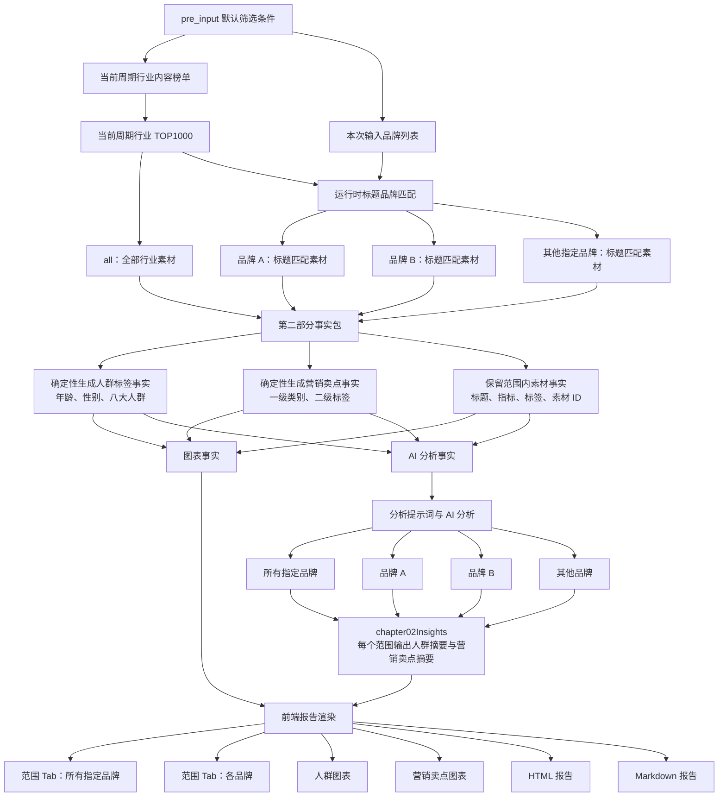

# 第二部分｜人群与营销卖点洞察链路

> 本图按当前代码和仓库内可读取的真实产物梳理。固定基线为 `RPA数据汇总/yuntu-rankings-analysis-20260810-20260820-top15 copy`；仓库内没有交接摘要所写的 `20260826` 批次，因此不把该目录当作本次已核验依据。

## 关键范围与事实边界

### 1. 样本范围

- `all` 是当前周期的行业 TOP1000；品牌 scope 是同一 TOP1000 内按标题匹配到该品牌的全部素材。品牌范围只来自本次输入，不从品类、画面或其他字段推断品牌。
- 第02章默认保留每个 scope 内曝光量为正且可排序的素材。当前真实基线的 scope 为 `all`、Joyoung soymilk/九阳豆浆、五个女博士、燕之屋、WONDERLAB/万益蓝，样本分别为 1000、83、264、129、292 条。
- 详情、秒级趋势和高光帧不参与第02章人群/卖点聚合；环比周期和同周期全行业列表也不参与第02章，它们属于第一章对比事实。

### 2. 人群事实的业务含义

- 人群事实是“素材被打上的年龄、性别、八大人群标签结构”，不是平台用户画像，也不是互斥的人群占比。一个素材可以命中多个标签，因此标签命中次数不能直接相加为真实人数。
- 当前固定三类维度为年龄、性别、八大人群。每个维度保留样本量、已标注/未标注数量、命中素材数和标签占比；没有用户级曝光、点击或转化的标签分层事实。
- 因此模型可以描述“哪些人群标签在素材池中更常出现”以及内容方向，但不能据此断言真实受众规模、购买人群结构或标签导致了效果变化。证据不足时应写“数据不足以判断”。

### 3. 营销卖点事实的业务含义

- 原始营销卖点按第一个下划线前的内容归为一级类别，剩余内容作为标签展示，同时保留原始标签用于审计。类别按标签出现次数排序，类别内保留标签出现次数和命中素材数，并提供 Top 标签及全部标签明细。
- 当前真实基线的 `all` scope 有 16 个一级类别、1485 个唯一标签、6307 次标签命中；品牌 scope 的类别数/唯一标签数/命中次数分别为：九阳 14/303/1047，五个女博士 16/482/1854，燕之屋 11/163/494，万益蓝 15/606/1561。历史设计文档中的 1399 个标签、5825 次命中属于旧批次口径，不能直接替代当前产物。
- 标签聚合本身只做归类和计数，不生成“卖点有效”“带来转化”等业务结论。当前第02章事实包也没有把单个卖点与 CTR、CVR 或播放率做确定性因果比较。

### 4. AI 输入与输出边界

- `audience-marketing-input.json` 是第02章的模型证据入口；提示词要求模型按固定 scope 顺序输出 `chapter02Insights`，每个 scope 仅包含人群摘要和营销卖点摘要。
- 人群摘要要求把八大人群、性别、年龄放在同一段中，并形成“事实锚点 → 判断/可能机制 → 内容策略 → 验证方向”；营销摘要围绕类别、Top 标签和命中素材给出取舍与验证方向。
- 输出 Schema 只允许 `audienceSummary`、`marketingSummary` 两个维度，每个维度包含标题、正文、证据和素材 ID。禁止把其他事实包的详情、高光或秒级趋势借入第02章，也禁止未经证实的因果、滋补/孕期/健康功效宣称。
- 规则代码只负责筛选、计数、归类和投影；业务判断由模型生成。模型输入与图表输入是分开的文件和用途，但当前两者基于同一份全量 scope 数据构造。

### 5. 前端投影与展示边界

- Presentation 为每个 scope 生成范围 Tab 和 panel，并显式记录 AI 事实源与图表事实源。AI 文案来自已验证的 `chapter02Insights`；图表、Tab 和素材范围来自 `chapter02Facts`。
- HTML 每个 panel 的顺序是：人群摘要、营销卖点摘要、人群图表、营销卖点图表。人群图表展示八大人群、年龄和性别；营销图表支持一级类别下钻到二级标签，并可展开全部标签明细。
- `topMaterials` 被嵌入 HTML 作为当前 scope 的排序素材集合。用户调整 Top N 后，浏览器重新计算人群和营销标签，两个图表同步变化；这只是展示交互，不改变 AI 已生成的摘要，也不重新执行 RPA。
- 报告 HTML 已使用新式 `audienceSummary`/`marketingSummary` 展示 AI 文案；Markdown 仍沿用旧数组字段读取方式，导致当前真实 Markdown 主要呈现 scope 事实明细而缺少新式 AI 摘要，这是已证实的渲染链路不一致。

## 当前实现中值得后续设计确认的要点

1. **AI 事实包是否应继续携带完整 `topMaterials`。** 当前模型输入除了人群和营销 Dashboard，还携带标题、指标、标签和素材 ID；提示词却要求第02章只引用两个 Dashboard。真实 AI 文案已经出现 CTR/CVR 等表现判断，说明这条边界存在实际可利用的通道。需要确认：是删减 AI 包中的指标/标题，只保留用于证据引用的 ID 映射，还是正式允许第02章引用这些字段并补充校验。
2. **证据 ID 是否需要按 scope 反查。** 当前报告校验只要求 `evidence` 非空且 `material_ids` 为数字字符串，没有逐个确认 ID 属于对应 scope，也没有校验证据文字是否确实来自该 scope 的标签统计。若第02章继续允许素材级证据，建议明确 scope 归属校验和证据粒度。
3. **第02章文本质量是否需要自动门禁。** Prompt 规定摘要句数、字符长度和“事实—判断—机制—策略—验证”结构，但当前 `yuntu_report.py` 对第02章主要校验字段存在性，不像第五章那样执行长度和占位词门禁。需要确认质量要求是仅靠 Prompt，还是提升为可自动验证的合同。
4. **Python 与浏览器是否存在两套事实计算源。** Python 生成初始 Dashboard，HTML JavaScript 又用 `topMaterials` 重算人群和营销标签；两边目前采用相同的标签集合和下划线解析规则，但未来 taxonomy 或缺失语义变化时可能出现初始图表与 Top N 图表不一致。需要确认浏览器重算是否长期保留，或改为由后端提供可切换的展示事实。
5. **Markdown 与 HTML 是否需要统一为同一 Presentation 投影。** 当前 HTML 已走 Presentation 的新式摘要，Markdown 仍直接读取旧式 insights 数组。需要确认 Markdown 是否与 HTML 同步展示两段 AI 摘要，还是定位为仅供审计的事实明细；两种定位都应在渲染契约中明确。
6. **“标签结构”与“真实人群分布”的免责声明位置。** Markdown 明确写出标签占比不代表真实人群分布；当前 HTML 图表通过标签名、命中素材数和可访问性文案表达，但没有同样完整的解释段。需要确认免责声明是否应成为 HTML 固定可见文案，避免业务方把标签占比误读为用户画像。
7. **历史口径与当前批次口径的版本化。** 旧设计曾以 1399 个唯一标签、5825 次命中作为基线，当前真实产物已是 1485/6307，说明标签 taxonomy 或批次数据变化会显著改变类别数量。后续设计应以产物中的 taxonomy 版本、批次和统计结果为准，不在文档或 Prompt 中硬编码旧数字。

## 证据入口

| 证据 | 用途 |
|---|---|
| `docs/mermaid/chapter01-material-ranking-data-flow.md` | 第一部分 Mermaid 结构基准 |
| `scripts/yuntu_analysis.py` | 第02章 scope 构造、事实包拆分、模型输入单元和 Schema |
| `scripts/yuntu_top_materials.py` | 人群维度枚举、标签计数、营销卖点分类与排序 |
| `prompts/yuntu-analysis-prompt.md` | 第02章模型消费范围、输出格式和业务禁语 |
| `scripts/yuntu_presentation.py` | scope、AI/图表来源声明、图表和交互投影 |
| `scripts/yuntu_report_sections.py` | HTML/Markdown 章节结构和图表渲染 |
| `scripts/templates/final-report-template.html` | Tab、Top N、图表下钻和标签明细交互 |
| `tests/test_yuntu_analysis.py`、`tests/test_yuntu_report.py`、`tests/test_yuntu_presentation.py` | 事实包、输出合同、渲染标记、双来源和交互回归 |
| `RPA数据汇总/yuntu-rankings-analysis-20260810-20260820-top15 copy/diagnostic-analysis/analysis-units/audience-marketing-input.json` | 当前可读取的第02章 AI 事实包 |
| `RPA数据汇总/yuntu-rankings-analysis-20260810-20260820-top15 copy/diagnostic-analysis/report-data.json` | 当前可读取的图表/报告事实投影 |
| `RPA数据汇总/yuntu-rankings-analysis-20260810-20260820-top15 copy/diagnostic-analysis/yuntu-ai-analysis.json` | 当前可读取的 AI 输出 |
| `RPA数据汇总/yuntu-rankings-analysis-20260810-20260820-top15 copy/final-report-optimized-20260901/final-report.html` | 当前可读取的 HTML 报告产物 |
| `RPA数据汇总/yuntu-rankings-analysis-20260810-20260820-top15 copy/final-report-optimized-20260901/final-report.md` | 当前可读取的 Markdown 报告产物 |
