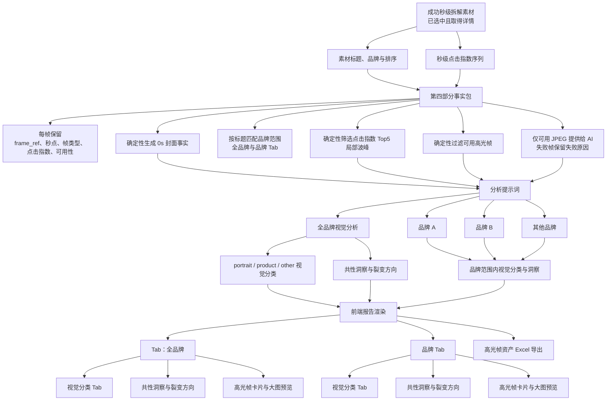

# 第四部分｜高光画面洞察与高光帧资产展示数据链路

> 本图沿用第一部分 Mermaid 梳理方式，聚焦“事实包 → 提示词/AI 分析 → 前端报告渲染”的业务链路。实现细节和跨章节旁支不在图中展开。

## 证据范围

- 实现证据：[`scripts/yuntu_highlights.py`](../../scripts/yuntu_highlights.py)、[`scripts/yuntu_batch.py`](../../scripts/yuntu_batch.py)、[`scripts/yuntu_analysis.py`](../../scripts/yuntu_analysis.py)、[`scripts/yuntu_presentation.py`](../../scripts/yuntu_presentation.py)、[`scripts/yuntu_report.py`](../../scripts/yuntu_report.py)、[`scripts/yuntu_report_sections.py`](../../scripts/yuntu_report_sections.py)、[`scripts/yuntu_highlight_export.py`](../../scripts/yuntu_highlight_export.py)。
- 提示词与契约证据：[`prompts/yuntu-analysis-prompt.md`](../../prompts/yuntu-analysis-prompt.md) 及 `scripts/yuntu_analysis.py` 中的 `highlightDashboard` Schema。
- 测试证据：`tests/test_yuntu_highlights.py`、`tests/test_yuntu_analysis.py`、`tests/test_yuntu_presentation.py`、`tests/test_yuntu_report.py`、`tests/test_yuntu_highlight_export.py`。
- 当前 checkout 可复核的真实产物样本：[`RPA数据汇总/yuntu-rankings-analysis-20260810-20260820-top15 copy/diagnostic-analysis/report-data.json`](../../RPA数据汇总/yuntu-rankings-analysis-20260810-20260820-top15%20copy/diagnostic-analysis/report-data.json)、同目录 `analysis-units/highlight-input.json`、`yuntu-ai-analysis.json`，以及 [`final-report/final-report.html`](../../RPA数据汇总/yuntu-rankings-analysis-20260810-20260820-top15%20copy/final-report/final-report.html)、`presentation-report.json`、`highlight-frames.xlsx`。
- 交接文档所称的 `20260826-top6/diagnostic-analysis-chapter04-v4-model` 在当前 checkout 中未找到；因此本文的真实产物数字只引用上述现存样本，不把交接摘要中的 28 帧数字当作本次证据。

## Mermaid 数据链路

## 关键范围与事实边界约束

- 第四部分的样本不是行业 TOP1000 全量，也不是第一部分的品牌榜单范围；它只消费已选中且成功取得秒级详情的素材。素材标题、排名和品牌匹配信息在第四部分主要承担识别、品牌分层和卡片展示作用，不能替代画面证据。
- 高光候选由代码确定性生成：固定保留 `0s` 封面，再从 `点击指数` 秒级序列中取最多 5 个局部波峰；同一素材的 `0s` 峰与封面合并。秒点按数值降序、秒数升序确定名次；没有有效峰不从普通点、`high_points` 区间或缺失数据补选。
- 详情中的 `high_points` / `loss_points` 会进入事实包和其他展示链路，但当前第四部分标准帧选择并不把它们当作补帧规则。`within_high_point` 只记录候选是否落在云图高点区间，不能证明画面导致点击或转化。
- `highlight-input.json` 的 `visualAssets` 是第四部分 AI 的唯一事实入口；提示词要求实际查看每张 `available=true` 的本地 JPEG。原视频 URL、失败帧和不可用原因不能被模型扩写成视觉结论。
- 视觉分类只有 `portrait`、`product`、`other`，并按画面主体、占比、视觉焦点和可辨识度判断；不得依据标题、标签或品牌猜分类。新版模型输出使用 `highlightDashboard.brands[].groups[]`，不再使用顶层 `groups` / `categories`。
- AI 只负责从真实画面写共性洞察和裂变方向；每个分类的 `frame_refs` 必须逐帧归类且不能重复，`common_patterns` 与 `derivative_directions` 必须同数、逐项对应。正文只能描述“处于点击指数峰值秒点”等观察，不能写成因果归因、真实点击量或帧与脚本话术的对应关系。
- 前端的品牌分层由“AI 归类的视觉类型”与“代码按标题匹配的品牌范围”共同决定。全品牌 Tab 展示全部可用帧；品牌 Tab 只展示标题匹配该品牌的帧。一个真实图片可以在全品牌 Tab 与对应品牌 Tab 重复展示，但 `frame_ref` 和本地资产身份不变。
- HTML 不直接使用远程视频或图片 URL；渲染器将可用帧复制到报告目录的 `assets/highlight-frames/`，再以本地相对路径渲染。Excel 只导出可用帧，每个事实帧一行并嵌入图片；图片墙只保留图片、标题和视觉类型，不承载排名或点击指标。
- 第五部分的 `materialDeepDives` 另行消费逐帧观察和秒级趋势；不能把第五部分的观察、脚本结论或趋势摘要回灌为第四部分的共性洞察。第一部分的榜单聚合、人群/营销事实也不作为第四部分 AI 的画面证据。

## 当前实现中值得后续设计确认的要点

1. **真实批次版本需要重新对齐。** 交接资料指向的 `20260826-top6` 与 `chapter04-v4-model` 产物在当前 checkout 缺失；现存可复核样本是 `20260810-20260820-top15 copy`。需要确认下一次链路文档和正式验收究竟以哪个批次、哪个 `analysis-unit` 版本为权威。

2. **标准高光数量与历史设计口径不完全一致。** 当前报告代码固定为“封面 + 点击指数最多 Top5 局部波峰”；通用 `generate_highlights()` 仍支持按配置趋势各取最多 3 个峰，但第四部分 `prepare_analysis()` 调用的是标准高光函数。若业务仍需要多指标或 Top3，应先确认统一口径，避免把通用能力误认为当前报告行为。

3. **品牌零帧的展示策略未显式定义。** 当前 Presentation 只投影实际拥有匹配帧的品牌分类；现存样本的输入品牌包含“五个女博士”，但其没有进入第四章品牌投影。需要确认品牌 Tab 是“无帧品牌隐藏”，还是应显示“暂无可用高光帧”的空状态。

4. **全品牌与品牌 Tab 的重复展示需确认用户口径。** 当前全品牌范围必须覆盖全部成功帧，品牌范围又按标题匹配重复投影，因此 Presentation 的帧卡片数会大于真实 JPEG 数。真实样本中 `report-data.json` 有 100 张可用帧，AI 全品牌也引用 100 个 `frame_ref`；Presentation 同时产生全品牌及品牌范围投影。应确认该重复是预期的导航体验，还是后续需要增加“资产唯一数/展示卡片数”的区分说明。

5. **AI 分类与品牌匹配的证据层级需要产品确认。** 视觉类型必须来自图片观察，但品牌归属来自标题匹配；标题未命中指定品牌的素材仍可进入全品牌范围并可能落到“其他品牌”。需要确认报告是否继续允许全品牌观察包含未命中品牌素材，以及是否在用户可见层标识该范围。

6. **Schema 的历史兼容分支尚未完全退休。** `yuntu_analysis.py` 和 `yuntu_report.py` 仍保留顶层 `groups`、旧分类别名等历史读取/校验路径，而当前提示词和新 Presentation 契约已经收敛到 `brands[].groups[]` 与 `brands[].categories[]`。需要确认兼容分支的保留期限和清理门槛，避免后续文档同时描述两套“当前契约”。

7. **失败状态的报告语义需要继续保持明确。** 真实样本中存在 `missing_video_url`、`download_failed` 等失败帧；代码会保留失败原因、跳过不可用图片并继续报告，但当一个素材完全没有可用帧时，它不进入第四部分 AI 视觉证据。需确认业务侧是否还需要在第四章展示失败素材清单，还是维持当前只在事实包/可用性状态中留痕。

8. **Excel 的品牌字段与 Presentation 的品牌作用域不是同一层。** 导出器按事实素材标题重新得到品牌字符串，再用 Presentation 的分类映射帧类型；Excel 一行一帧，不按全品牌/各品牌 Tab 展开复制。需要确认这是否是期望的“资产去重交付”，以及是否应把标题匹配规则版本写入工作簿元数据。

## 现存真实样本的可复核结论

- `report-data.json`：18 条已选素材，100 张 `available=true` 高光帧；失败帧原因包含 `missing_video_url` 和 `download_failed`。
- `highlight-input.json`：包含 `visualAssets`、本地相对 `image_path`、`frame_ref`、秒点、封面/点击峰值类型和可用性，符合“成功 JPEG 进入模型视觉分析、失败记录不进洞察”的输入分层。
- `yuntu-ai-analysis.json`：`highlightDashboard.brands` 首项为“全品牌”，按 `portrait`、`product`、`other` 输出；全品牌覆盖 100 个帧引用，品牌作用域按标题匹配得到九阳豆浆 42 帧、燕之屋 6 帧、WONDERLAB/万益蓝 30 帧。
- `presentation-report.json`：第四章使用 `chapters.chapter04.brands[].categories[]`，未使用新的顶层 `categories`；第四章与第五章在 Presentation 层保持独立。
- `highlight-frames.xlsx`：包含“高光帧资产”和“高光帧图片墙”两个 Sheet，真实 XLSX 内含图片媒体文件；HTML 报告包含品牌/视觉分类 Tab、共性洞察、裂变方向、高光帧卡片、分页和本地图片预览。
