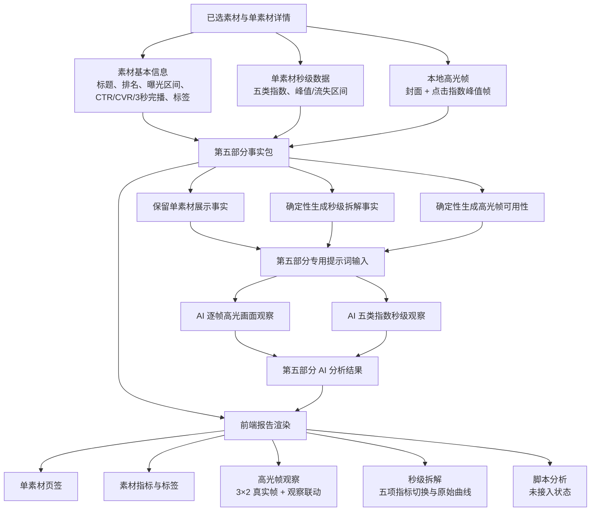

# 第05部分｜单素材深度分析数据链路

> 本图是第05部分「单素材深度分析」从成功详情事实、高光帧与秒级拆解，到提示词/AI分析，再到离线报告渲染的固定链路基准。第一部分只消费榜单事实；本部分只消费已选素材的详情事实与其本地高光帧。

## 关键范围与事实边界

- **范围入口。** 第05部分以 `batch-manifest.json` 的 `selectedMaterials` 为准，沿 `detailRecordPath` 读取单素材详情；没有成功秒级详情的素材不进入成功详情分析范围。`reportScopes.detail` 记录该范围的成功/失败数量，不能用 TOP1000 榜单样本补齐。
- **事实来源分工。** 标题、排名、曝光区间、CTR、CVR、3 秒播放率和标签来自榜单素材主档；秒级趋势、高点/流失区间和脚本可用性来自素材详情；高光图像来自本地帧清单与 JPEG。第05部分不借用第一、二、四部分的 AI 结论或事实包。
- **确定性秒级规则。** 只接受 `点赞指数`、`流失指数`、`点击指数`、`互动指数`、`评论指数`，按秒合并并排序；同一秒出现冲突值、趋势未返回或没有可用点时标记不可用并保留原因，不用空数组伪装为可用数据。
- **确定性高光规则。** 当前标准候选是 0 秒封面加点击指数局部峰值最多 5 帧；峰值在 0 秒时与封面合并，因此实际帧数可以少于 6。不可用帧保留失败原因，不生成伪路径，也不因视频 URL 失效而补造画面。
- **05 专用模型边界。** `material-deep-dive-input.json` 经过字段收敛，只给模型 `material_id`、高光帧的引用/秒数/类型/可用性/本地图片路径，以及五类秒级事实；不把榜单指标、标签、排名、标题、帧峰值说明等重复字段作为第五章 AI 证据。
- **AI 输出边界。** 每个入选素材输出一项 `materialDeepDives`；逐帧观察只能引用本素材的可用帧，秒级观察只能引用本素材趋势中真实存在的秒数。AI负责可观察内容与趋势解释，不能重新计算指标、编造脚本/话术/真实互动量、转化或因果结论。
- **前端投影边界。** `build_yuntu_presentation` 以 `chapter05.panels` 作为第五章唯一面板源：事实负责标题、指标、标签、帧和曲线，AI负责逐帧观察与秒级观察。HTML 不播放视频；脚本页以未接入状态展示。桌面端主视觉维持 `3×2`，高光帧选择只控制观察内容的显示，不改变事实或 AI 原文。

## 当前实现中的已有优化

- 第五章模型输入已做专用收敛，避免把第一章榜单指标和标签复制进单素材 AI 证据；Presentation 也删除了未被渲染器消费的顶层素材别名，页签和交互声明由同一组 `tabs` 生成。
- 高光帧已采用本地 JPEG 优先的帧优先方案，避免依赖易过期的视频 URL；成功帧按 `frame_ref` 与 AI 观察一一绑定，前端提供单选/多选、全选和清空后的观察联动。
- 秒级图表固定五项指标顺序，使用真实秒点的原始折线，并保留高点和流失区间覆盖；范围滑杆、点位提示和键盘可聚焦点位均在模板内完成。
- 报告入口先执行分析契约校验，再生成 `PresentationReport v1`，可校验入选素材覆盖、成功帧恰好一次和 `evidence_seconds` 是否存在于对应趋势。

## 真实产物快照（证据，不等同于规则）

以 `RPA数据汇总/yuntu-rankings-analysis-20260810-20260820-top6/diagnostic-analysis-latest-taxonomy-20260902-chapter01-comparison-cards/` 为例：

- `report-data.json` 为 schema 7，包含 18 个入选素材（排名 1–18），详情成功 18 个；每条均返回五类秒级趋势、高点和流失点。
- `materialFacts` 共 107 条高光帧记录，其中 18 张封面、89 张点击峰值帧；100 张可用 JPEG、7 条不可用记录。AI 输出包含 18 项深度分析、100 条逐帧观察和 90 条秒级观察（每素材五项）。
- `presentation-report.json` 的第五章包含 18 个素材页签和 18 个面板；第一面板为 `complete`，秒级指标顺序为上述五项。最终 HTML 以 `assets/highlight-frames/` 的本地图片渲染第五章。
- 该批次 18 条详情的脚本正文、脚本分段和内容公式均为 `source_empty`，所以最终报告的“脚本分析”只能是未接入状态。

## 后续设计需要确认的要点

1. **入选数量的业务口径。** 当前代码直接消费 `selectedMaterials`，真实批次目录名虽含 `top6`，实际却渲染了 18 个素材。需要确认第五章应展示所有成功详情，还是按一个明确的 `target-top-n`/品牌配额再次收敛；否则“TOP6”和页面 18 个页签容易产生口径冲突。
2. **提示词质量要求与程序门禁是否统一。** 提示词要求逐帧观察至少 40 个中文字符、秒级总结至少 60 个中文字符，并隐含每项趋势都要有观察；当前 JSON Schema 只约束字符串，报告校验的最小长度仍是 24/28，且允许缺少某些秒级观察或空的 `evidence_seconds`。需要决定这是软质量要求还是应提升为 Schema/运行时硬门禁。
3. **因果和机制化措辞的边界。** 当前提示词禁止把峰值写成原因或效果，但现有真实 AI 文本仍出现“触发、驱动、证明、带动、提升”等因果/效果化表达；校验器已拦截“导致/提升/转化”等词，却未覆盖全部同义表达。需要确认第五章只允许“同秒出现/可观察到”的描述，还是允许带限定词的机制假设，并据此统一词表和复核规则。
4. **事实包、AI 输出与报告的版本绑定。** CLI 支持 `attest-analysis` 和 provenance 校验，但上述最新诊断目录未看到独立 provenance 文件，最终报告数据也只有在传入回执时才写入 `analysisProvenance`。需要确认正式交付是否必须保留事实包、提示词、Schema、AI 输出和渲染结果的哈希回执，并将其纳入验收清单。
5. **可用性状态的展示粒度。** 当前 Presentation 的面板状态主要由可用帧和五项秒级事实决定，AI 观察缺失由校验失败处理，脚本缺失则由固定脚本页表达。需要确认是否要把“帧部分可用、趋势部分可用、AI 观察部分可用、脚本未接入”合并成面向业务的状态摘要，而不是分别散落在面板内部。
