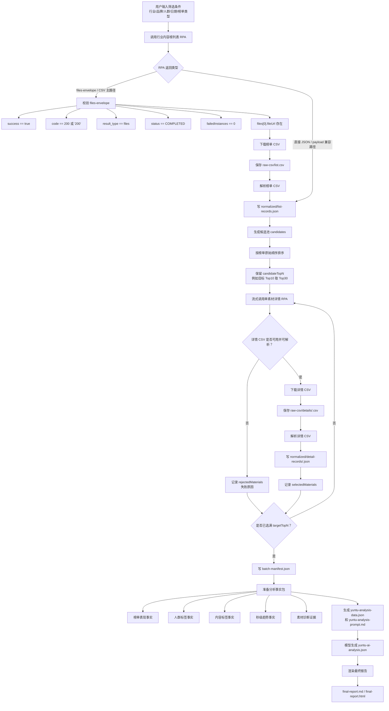

# 云图行业内容榜单分析后续能力设计

## 背景

当前技能已经能通过固定预策 RPA connector 获取云图行业内容榜列表，并按列表响应顺序选取 Top N 的唯一数字型 `material_id`，再请求单素材详情。后续能力需要在这个取数基础上，形成可复用的行业内容榜分析报告。

新的设计以 RPA 大概率返回 CSV 文件为主路径。JSON 样例只用于理解云图字段含义，不作为分析阶段的固定输入假设。

## 目标

将技能从“RPA 取数和落盘工具”扩展为“行业榜单取数、素材详情规范化、秒级趋势归因和业务报告生成工具”。

交付结果应回答：

- 本次筛选条件下，哪些 Top 素材可进入有效分析样本。
- 这些素材在 CTR、CVR、PVR、完播率、平均播放时长等指标上的表现分层。
- 人群标签、内容标签、卖点、场景和素材形态有哪些高频共性。
- 单素材在点赞、点击、互动、评论和流失指数上的关键秒段。
- 小仙炖可以借鉴哪些创意结构、卖点表达和下一轮素材方向。

## 非目标

- 不下载视频，不抽帧，不做画面级识别。
- 不把 RPA 临时 `fileUrl` 当作最终产物。
- 不让分析逻辑直接读取原始 CSV 或原始 RPA response。
- 不隐藏 RPA 失败、CSV 下载失败或 CSV 解析失败的素材。
- 不照搬千川技能的字段、峰值规则或 HTML 页面结构。

## 推荐方案

采用三段式流程：

1. `fetch`：调用 RPA、识别 files-envelope、下载 CSV、解析 CSV、写入规范化 JSON records 和批次 manifest。
2. `prepare-analysis`：读取规范化 records，生成稳定的云图分析事实包和分析 prompt。
3. `render-report`：读取模型生成的结构化分析 JSON，渲染 Markdown 或 HTML 报告。

这样可以复用千川技能的工程模式：原始文件保留、规范化 records、批次 manifest、事实包、模型分析、报告渲染；同时让云图自己的字段和分析口径保持独立。

## 流程图



## RPA 输出适配

RPA 输出适配层必须支持两种返回形态：

- CSV 主路径：RPA 返回 `data.result_type == "files"`，技能校验 files-envelope 后下载 `files[0].fileUrl`。
- 兼容路径：RPA 直接返回 JSON、payload list 或 JSON string payload。

files-envelope 校验规则：

- `success == true`
- `code == 200` 或 `"200"`
- `data.result_type == "files"`
- `data.result_content.status == "COMPLETED"`
- `data.result_content.failedInstances == 0`
- `data.result_content.files` 非空
- `files[0].fileUrl` 是非空字符串

下载后的 CSV 必须保留到本地。CSV 解析失败是该素材或该阶段的阻塞失败，不能静默解释为无数据。

## 批次选材与补位

用户输入的 `targetTopN` 是最终希望分析成功的素材数。技能应从榜单 records 中先建立更大的候选池 `candidateTopN`，例如默认 `candidateTopN = targetTopN * 3`。

候选池按榜单原始顺序排列。流式调用详情 RPA 时，从候选池头部提交，直到：

- `selectedMaterials` 数量达到 `targetTopN`；或
- 候选池耗尽。

批次状态分为：

- `selectedMaterials`：详情 CSV 成功下载、解析，并生成规范化详情 records。
- `rejectedMaterials`：RPA 请求失败、files-envelope 无效、CSV 下载失败、CSV 解析失败或缺少必要字段。
- `cancelledMaterials`：目标 Top N 已满足后，未提交的剩余候选。

`batch-manifest.json` 应记录候选数量、实际提交数量、入选数量、失败原因、原始 CSV 路径、规范化 JSON 路径和每个阶段耗时。

## 文件结构

推荐运行目录：

```text
run/
  batch-manifest.json

  raw-csv/
    list.csv
    details/
      <material_id>.csv

  raw-json/
    list-response.json
    details/
      <material_id>.json

  normalized/
    list-records.json
    detail-records/
      <material_id>.json
    top-materials-rpa-ready.json

  diagnostic-analysis/
    yuntu-analysis-data.json
    yuntu-analysis-prompt.md
    yuntu-ai-analysis.json

  final-report/
    final-report-data.json
    final-report.md
    final-report.html
```

`raw-csv/` 是主路径。`raw-json/` 只用于少数直接返回 JSON 或 payload 的兼容场景。后续分析阶段只能读取 `normalized/` 和 `diagnostic-analysis/`。

## 规范化 records

榜单 records 应至少规范化出：

- `material_id`
- `title`
- `rank`
- `video_duration`
- `metrics`：CTR、CVR、PVR、播放率、完播率、平均播放时长、曝光等
- `people_tags`：年龄、性别、八大人群等
- `material_tags`：卖点、场景、包装、功效、素材形态等
- `source_paths`：原始 CSV 或 JSON 的相对路径

详情 records 应至少规范化出：

- `material_id`
- `date_range`
- `video_url`，仅作为素材详情证据，不作为下载视频的要求
- `trend_series`：点赞、点击、互动、评论、流失等趋势序列
- `high_points`：每类趋势的高点秒段
- `loss_points`：流失秒段和流失比例
- `source_paths`：原始 CSV 或 JSON 的相对路径

分析逻辑只消费这些规范化字段，不直接依赖 CSV 列名或 RPA 原始嵌套结构。

## 分析事实包

`prepare-analysis` 读取 `normalized/` 后生成 `diagnostic-analysis/yuntu-analysis-data.json` 和 `diagnostic-analysis/yuntu-analysis-prompt.md`。

事实包应包含：

- `schemaVersion`
- `filters`
- `selectedMaterials`
- `rejectedMaterials`
- `summaryMetrics`
- `audienceAggregations`
- `tagAggregations`
- `trendHighlights`
- `materialFacts`

每条 `materialFacts` 包含：

- 素材基础信息：标题、`material_id`、视频时长、发布时间
- 榜单指标：CTR、CVR、PVR、完播率、平均播放时长、曝光
- 人群标签：年龄、性别、八大人群
- 内容标签：场景、卖点、功效、包装、素材形态
- 秒级趋势：点赞、点击、互动、评论高点和流失点
- 初步诊断证据：高点秒段、流失秒段、对应趋势名称

## 模型分析输出

模型读取事实包后生成 `diagnostic-analysis/yuntu-ai-analysis.json`。该 JSON 应聚焦业务事实，不写执行过程、代码状态、重跑、补位调度或排障细节。

建议结构：

- `overallConclusion`：本批次 Top 素材组合结论
- `rankingInsights`：榜单表现分层
- `audienceInsights`：人群洞察
- `tagInsights`：内容标签和卖点洞察
- `trendInsights`：秒级趋势洞察
- `materialAnalyses`：单素材诊断
- `creativePatterns`：高表现素材共性
- `nextActions`：小仙炖下一轮素材建议

所有结论应引用事实包中的素材 ID、指标、标签或趋势秒段作为证据。事实不足时，在对应字段中明确写“数据不足以判断”。

## 最终报告

`render-report` 不调用外部模型，只校验并渲染 `yuntu-ai-analysis.json`。

最终报告结构：

1. 行业榜单整体结论
2. Top 素材表现分层
3. 人群与内容标签洞察
4. 单素材秒级诊断
5. 高表现素材共性
6. 小仙炖可借鉴创意方向
7. 下一轮素材建议

报告可以优先产出 Markdown，后续再增加 HTML 渲染。报告应保留失败素材数量和失败原因摘要，但业务结论只基于 `selectedMaterials`。

## 错误处理

- 列表 RPA 失败：写入 manifest，非零退出，不提交详情 RPA。
- 列表 CSV 下载或解析失败：非零退出，不进入候选池。
- 详情 RPA 失败：记录 rejected，继续补位。
- 详情 CSV 下载或解析失败：记录 rejected，继续补位。
- 候选池耗尽仍未选满目标 Top N：非零退出，但保留已完成原始文件、规范化 records 和 manifest。
- 事实包缺少必要数据：`prepare-analysis` 非零退出，不生成空报告。
- 渲染器发现 schema 或证据引用错误：非零退出，要求修正 `yuntu-ai-analysis.json` 后重跑。

## 测试策略

- RPA files-envelope 校验：覆盖成功、状态未完成、失败实例数非零、无文件、无 `fileUrl`。
- CSV 下载：覆盖空文件、HTTP 失败、原子替换、临时文件清理。
- CSV 解析：覆盖正常记录、字段缺失、重复表头、分隔符错误、嵌套 JSON 字符串解析。
- 规范化：覆盖 `material_id` / `materialId` 差异、数值字符串转数值、空标签、趋势高点和流失点。
- 批次补位：覆盖 Top N 全成功、前序失败后补位、候选池耗尽、取消未提交候选。
- 事实包：覆盖聚合指标、人群标签、内容标签、趋势证据和 rejected 摘要。
- 报告渲染：覆盖完整报告、部分数据报告、schema 错误和证据引用错误。

## 验收标准

- `fetch` 在 CSV 主路径下能保留原始 CSV，并写出规范化榜单和详情 records。
- `batch-manifest.json` 能准确区分 selected、rejected 和 cancelled。
- `prepare-analysis` 只读取规范化 records，生成可供模型分析的事实包。
- `render-report` 只读取结构化分析 JSON，不生成新的业务判断。
- 所有业务结论都能追溯到事实包中的素材 ID、指标、标签或秒级趋势。
