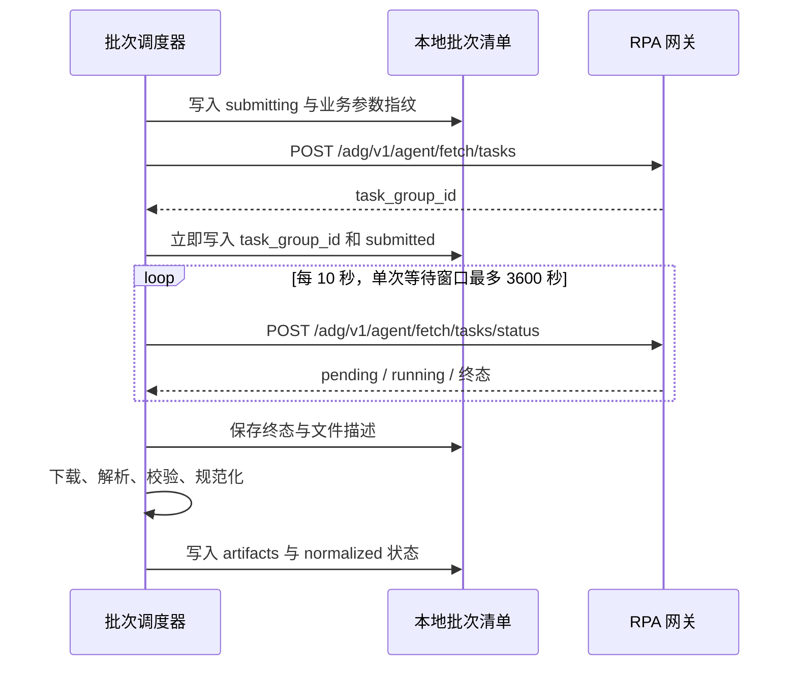

# 云图素材详情连接器直接替换设计方案

## 2026-09-25 当前补充：首批 CSV 门禁

下方保留 2026-09-07 的设计记录。当前采集器在最多 3 条详情组成的首批外增加 `firstBatchCsvGate`：首批 ID 在下发前持久化；每项真实下载且解析后，须有明确素材身份及详情业务结构，并通过当前周期校验，才记 `valid_csv`。合法空趋势不等于空 CSV；视频下载和抽帧失败不撤销已通过的数据验收。JSON payload 只作旧数据兼容，不能代替新请求的 CSV。

首批全部结果确认而有效 CSV 为 0，整体 `status=paused`、门禁 `status=blocked`、`errorCode=first_batch_no_valid_csv`，不再提交任何后续 RPA（下一批、失败补位、重试、恢复时新榜单）。CLI 和只读 `status` 提示入参可能有问题及账号、日期、筛选/素材定位参数复核方向；修正后必须新建运行目录验证首批。普通恢复在任何新 RPA 之前读取持久门禁，不自动解除 `blocked`。

首批出现提交不明、轮询超时、网络或未知状态时为 `unconfirmed`，保留已知 `task_group_id`；恢复只观察已提交首批，不重发。没有可追踪 ID 时保持暂停。首批全部可确认且至少 1 份有效 CSV 才 `passed`，此后保留原有限定候选组的补位行为。manifest 与 run-summary 同步门禁和每项验收结果，旧批次恢复也不能只凭 normalized JSON 绕过 CSV 证据。这一补充覆盖下方历史“失败继续补位”的默认行为。

- 日期：2026-09-07
- 状态：设计完成，等待新连接器正式上线后执行同步；尚未实施、未做线上验证。
- 目标技能：`yuntu-industry-content-rankings-analysis`
- 执行方案：[云图素材详情连接器直接替换执行方案](../plans/2026-09-07-yuntu-details-connector-migration.md)

## 1. 决策与范围

新连接器正式上线后，所有新详情请求直接使用 `rpa.conn.juliang.yt.industry.content.rankings.details`，替代当前 `rpa.conn.juliang.yt.industry.content.rankings.detail`。不增加连接器选择参数、新旧双跑或自动回退。旧格式兼容仅用于读取历史数据，不允许历史批次恢复时重新调用旧连接器。

列表继续使用 `rpa.conn.juliang.yt.industry.content.rankings.list`。列表与详情的传输统一参考预策 RPA 工具包的异步任务协议；榜单筛选、TOP1000 品牌分析范围、候选补位、五章报告、Excel 和离线 ZIP 交付逻辑保持现有业务口径。

本次设计包括请求参数替换、异步任务恢复、文件落盘与数据规范化、来源校验、事实消费者适配和上线验收。新增人群与核心数据先沉淀为可追溯事实，不在本次迁移中新增报告章节或改写客户分析方法。

“正式上线后同步”指启动本执行方案所列的代码、知识页与验证工作。本方案不创建上线监控或定时任务，也不将文档存在等同于已上线。

## 2. 依据与已验证现状

### 2.1 权威输入

| 来源 | 用途 |
| --- | --- |
| `/Users/shuzida/Desktop/FDE客户/RPA汇总/云图-行业灵感-素材详情.md` | 新连接器代码、业务入参、五个详情区块、嵌套 JSON 样例 |
| `/Users/shuzida/Desktop/FDE客户/RPA汇总/云图-行业内容榜-素材详情秒级拆解.md` | 旧连接器契约 |
| `/Users/shuzida/Desktop/yuce-plugin/查数工具包/skills/预策RPA连接器取数/SKILL.md` | 平台路由、固定元数据、异步执行与观测原则 |
| 上述工具包内 `references/platforms/juliang-yt.md`、旧详情知识页及对应脚本 | 实际异步请求、状态查询、超时和终态处理实现 |
| `RPA数据汇总/yuntu-rankings-analysis-20260810-20260820-top12/raw-csv/latest-details/` | 新详情 CSV 的真实格式样本 |
| `scripts/rpa_connector.py`、`rpa_io.py`、`yuntu_batch.py`、`yuntu_run_state.py`、`yuntu_normalizer.py` | 当前技能实际执行链路 |

截至本次检查，参考工具包的云图知识地图仍只登记旧详情和列表；不能从该工具包当前目录推断新连接器已上线。上线后重新读取正式知识页、schema 和执行附件，如与本设计快照不一致，先更新契约差异及测试，再实施同步。

### 2.2 当前链路

当前 `_invoke()` 使用 `POST /adg/v1/agent/invoke`，请求超时 300 秒。列表和详情代码在常量及函数分支中重复写死。业务参数验证在技能入口完成，详情使用 `date_range_type`。

当前列表调度最多并发 3：CUSTOM 的三类榜单参数齐备时可并发提交；相对周期的本期和全行业先并发，上一周期等待本期实际日期回显后提交。沿用现有 `build_ranking_run_specs()` 的真实依赖，不因迁移把全行业请求错误地串行到本期之后。详情从榜单选择数字型素材 ID，分波并发 3，失败补位；高光处理独立并发 3。每波仍等待详情与高光全部终态，后续性能规划另行评估是否放开该历史约束。

`rpa_io.unpack_gateway_result()` 主要支持旧 `data.result_content.files`，且只取第一个文件；对异步 `status=completed, files=[...]` 返回不能正确解包，带 `success=true` 的未知外壳还有被误认为业务记录的风险。

`collection_status()` 仅检查本地文件。现有 `submittedMaterials` 未保存远端任务 ID；进程中断后不能据此接回远端结果。采集契约包含账号、筛选和数量，不包含连接器代码与规范化版本。

### 2.3 本地样本核验

已使用现有 `parse_csv_records()` 和 `normalize_detail_records()` 逐份读取，结果如下。

| 素材 ID | CSV 数 | 五类曲线各自点数 | 脚本字符数 | 内容公式 |
| --- | --- | --- | --- | --- |
| `7637892510163533850` | 1 | 48 | 273 | 有 |
| `7655594573390397466` | 1 | 62 | 0 | 空 |
| `7659409261740343346` | 2 | 42 | 253 | 有 |
| `7675632234864607232` | 1 | 33 | 0 | 空 |
| `7676833114073907209` | 1 | 54 | 284 | 有 |

- 共 6 个文件、5 个唯一素材，每个文件一条业务记录，125–144 列；不能固定列数。
- 重复素材两份文件仅 `videoUrl` 不同，不应生成两条素材分析。
- 全部 `dateType=LAST_7_DAYS`，自定义日期为空。父目录中的 `20260810-20260820` 不能用于证明这些详情的周期。
- 所有样本有 `audiencePortrait.*` 列，当前规范化器没有保留该区块。
- 新 CSV 曲线和脚本已部分兼容；文档中的新嵌套 JSON 实测得到 0 条曲线、空脚本、空核心指标，必须补齐。
- 当前 `_flat_content_formula()` 将标题、画面和脚本的 `detail.<标签 ID>` 合并，真实样本的 40、42 等标签存在来源覆盖。
- 样本不含 `scriptSegments`。缺少脚本时间戳是源数据边界，不通过推断补齐。

样本验证只证明文件适配现状，不证明新连接器线上可调用、账号可用、视频链接有效或整个报告已验收。

## 3. 新旧连接器契约

| 项目 | 旧 | 新 |
| --- | --- | --- |
| function_code | `rpa.conn.juliang.yt.industry.content.rankings.detail` | `rpa.conn.juliang.yt.industry.content.rankings.details` |
| platform | `RPA_JULIANG_YT_ACCOUNT_PASSWORD` | 相同 |
| data_source_type | `rpa` | 相同 |
| 周期字段 | `date_range_type` | `date_type` |
| 周期枚举 | `LAST_7_DAYS / LAST_30_DAYS / CUSTOM` | 相同 |
| 自定义日期 | `custom_start_date / custom_end_date` | 相同；支持两种日期格式，结束不早于开始 |
| 素材 | `material_id`，纯数字字符串 | 相同 |
| 输出周期 | `dateRangeType / startDate / endDate` | `dateType / customStartDate / customEndDate` |
| 输出详情 | `trends[]`、视频 | `coreData / audiencePortrait / secondTrend / contentFormula / creativeBreakdown`、视频 |

### 3.1 参数入口

- 保留 `--detail-date-range-type`、`--detail-custom-start-date`、`--detail-custom-end-date` 作为现有命令兼容入口，不再新增同义 CLI 参数。
- CLI 在进入 `fetch_batch_analysis()` 前构造新业务键 `date_type`；Python 采集内部、`detailDateRange` 和 `detail-request-params.json` 统一使用新键。
- `validate_detail_business_params()` 仅接受新连接器四个业务字段；不把旧 `date_range_type` 透传到线上。旧状态文件走历史读取路径，不混入新请求验证器。
- 从同一周期配置产生列表与详情参数。现有两组 CLI 参数都填写时校验枚举一致；CUSTOM 日期解析后逐端一致，不一致在任何网络请求之前失败。
- `material_id` 从已验证榜单选择；候选分组 ID、品牌、触点是本地上下文，不属于详情 schema，不发送，也不要求新连接器回显。
- 运行时凭证只取现有环境变量，沿用账号查询；不写入状态、文档证据、测试夹具和错误日志。

新详情业务参数示例：

```json
{
  "material_id": "7659409261740343346",
  "date_type": "CUSTOM",
  "custom_start_date": "2026-08-20",
  "custom_end_date": "2026-08-26"
}
```

### 3.2 固定路由

在 `rpa_connector.py` 维护唯一的 `LIST_FUNCTION_CODE` 和 `DETAIL_FUNCTION_CODE`。提交函数根据受控的 `operation=list/detail` 选常量，禁止接收外部 `function_code`。运行代码不保留旧详情代码分支；旧代码字符串仅可存在于历史兼容说明和测试中。

## 4. 调用、状态与恢复

### 4.1 异步协议



提交 body 沿用 `authorization / agent_session_id / data_source_type / platform / function_code / business_params / shop_id`。状态查询只提交 `authorization / task_group_id`。响应先校验 HTTP 与网关 `success=true`，再读取 `data`；该层成功不代表采集完成。

参考实现参数为 HTTP 单次 30 秒、内部轮询 10 秒、单任务提交加等待 3600 秒。调度器从提交前计时，拿到 ID 后把扣除提交耗时的剩余秒数传给等待函数；不能提交后再无条件追加完整 3600 秒。恢复已有任务只开启新的有限查询窗口，保留原提交时间及各次恢复记录，不重置为新任务。整批可能有多轮任务，不把 3600 秒解释为整批承诺。

外层进程观测参考第 3 秒、第 30 秒、之后每 60 秒；长批次需要继续观测时使用已有进程标识，不能因为观测窗口结束而重新运行 `fetch`。任何退出立即收集退出码和最终日志。

### 4.2 接口与写入归属

不增加外部脚本子进程依赖，借鉴参考工具包实现到本技能现有模块。

```python
# rpa_connector.py：只负责网络和协议，不写批次文件。
def submit_fetch_task(operation, shop_id, business_params, *, environ=None, session=None) -> str:
    """提交一次，返回 task_group_id；提交失败不自动重试。"""

def query_fetch_task(task_group_id, *, environ=None, session=None,
                     request_timeout_seconds=30) -> dict:
    """只查询一次，返回已验证的 data 对象。"""

def wait_fetch_task(task_group_id, *, environ=None, session=None,
                    timeout_seconds=3600, poll_interval_seconds=10) -> dict:
    """仅查询既有任务；返回终态，异常携带 task_group_id。"""

# yuntu_batch.py：拥有批次文件副作用。
def resume_batch_analysis(*, output_dir, invoker, downloader=None) -> int:
    """恢复已登记任务及缺失本地产物，不提交新任务。"""
```

`ConnectorInvoker` 改为注入 `submit_fetch_task / query_fetch_task / wait_fetch_task` 三个操作。调度器采用“提交 future → 主线程保存任务 ID → 等待 future → 主线程保存终态与产物”。工作线程不更新共享 manifest；不使用 worker callback 与主线程同时写同一 JSON。

保留最多 3 个详情在途任务，提交成功到远端终态均占用槽位；高光仍独立并发 3。同一输出目录的写命令串行执行，执行入口检测已有活跃 writer 时拒绝第二个 writer；只读 `status` 可并发。实现使用该目录的进程锁，锁资源由上下文管理器在异常退出时释放，不将状态文件是否存在当作运行锁。

### 4.3 持久化契约

`batch-manifest.json` 为任务账本权威源，新增 `taskRuns`；`run-summary.json` 只保存汇总投影。先原子写 manifest，再写 summary；中断后从 manifest 与文件哈希重建 summary，不从旧 summary 覆盖新 manifest。

任务 key：列表 `list:query / list:previous_period / list:industry`，详情 `detail:<material_id>`。每个 key 保存尝试数组，不覆盖历史失败任务 ID。

```json
{
  "taskRuns": {
    "detail:7659409261740343346": {
      "operation": "detail",
      "functionCode": "rpa.conn.juliang.yt.industry.content.rankings.details",
      "businessParams": {"material_id": "7659409261740343346", "date_type": "LAST_7_DAYS"},
      "attempts": [{
        "attempt": 1,
        "taskGroupId": "example-task-id",
        "requestStatus": "submitted",
        "remoteStatus": "pending",
        "artifactStatus": "pending",
        "submittedAt": "2026-09-07T10:00:00+08:00",
        "lastObservedAt": "2026-09-07T10:00:10+08:00",
        "errors": [],
        "artifactPaths": []
      }]
    }
  }
}
```

该 JSON 是结构示例，不是当前存在的任务。时间与示例 ID 不可作为上线证据。

| 维度 | 状态及含义 |
| --- | --- |
| requestStatus | `submitting` 提交前已记账；`submitted` 已保存 ID；`submit_unknown` 提交结果不确定；`submit_failed` 明确拒绝 |
| remoteStatus | `pending / running / completed / partial_success / failed`；查询未能确认时保持上次状态并记录错误 |
| artifactStatus | `pending / downloaded / normalized / failed`；`normalized` 只证明该任务的数据验收通过 |
| 批次状态 | 沿用 success/partial 等现有语义，所有必要榜单通过、目标达标且无未解决任务/错误才可 success |

HTTP 超时可能发生在网关已接受提交之后。无任务 ID 的 `submit_unknown` 不能保证幂等，放入 unresolved，不自动提交或宣称 exactly-once。若“响应已到但写盘前崩溃”，同样按不确定任务处理。

### 4.4 恢复与失败规则

| 情况 | 动作 |
| --- | --- |
| 已知 ID，查询超时/网络错误/3600 秒到期 | 保留 ID 与上次状态，批次未完成；通过 resume 继续查询 |
| 远端 completed，本地下载失败 | 重取该任务文件清单或重新下载，不提交 RPA |
| 文件已落盘，规范化失败或中断 | 校验原文件哈希后重新解析，不下载或提交无关素材 |
| 已有 normalized 文件 | 校验采集契约、素材/周期、来源哈希和版本，再复用；不能仅检查文件存在 |
| partial_success | 保存全部可用文件与 errors；有效素材可供部分分析，批次不标完整成功 |
| 明确 failed / submit_failed | 记录失败，沿用候选补位；显式 retry-failed 可发起新尝试，仍只用新连接器 |
| 无 ID 且 submit_unknown | 保持 unresolved；retry-unresolved 仍需要用户明确接受重复请求风险 |
| 未知状态/未知外壳 | 保留脱敏证据、报协议错误，不当成 payload，不自动切旧连接器 |

`status --output-dir` 保持纯本地查询。新增 `resume --output-dir`，账号从已保存契约读取；恢复仅处理既有任务，不提交尚未请求的候选。继续完整采集用同契约 `fetch`，它先恢复已有任务再提交尚未处理的项；不确定任务不重发。

现有 `_finalize_details(... require_no_unresolved=False)` 等路径需统一收紧；未知远端任务不能被数量达标掩盖。高光处理状态继续独立展示，完整报告仍遵守现有高光与交付验收门槛。

## 5. 文件与规范化设计

### 5.1 返回解包

`unpack_gateway_result()` 保持原函数名，扩展 `GatewayResult` 为 `kind / records / files / remote_status / errors / task_group_id`。新业务路径统一遍历 `files`；旧 `file_url` 仅保留单文件兼容属性，消费者不再依赖它。

接受经过验证的异步终态 `data` 对象或其完整网关外壳，及既有旧文件外壳/历史 records。文档只确认终态含 files/errors，文件项具体字段以上线捕获样例为准；当前以参考实现使用的 `fileUrl` 建 fixture，不臆造新字段名或无限递归扫描所有 URL。

只对显式 files/payload 分支解包。payload 支持单业务对象或对象数组，单对象转一行；必须具有对应业务身份/结构，`success=true` 本身不是记录。旧 records 兼容也必须经过业务规范化校验。

新原始文件保存于 `raw-csv/tasks/<task-key-safe>/<attempt>/<index>.csv`，JSON 对应 `raw-json/tasks/...`；task key 文件名使用本地白名单字符替换，不使用远端文件名构造任意路径。保存每个文件的来源描述、字节数、SHA-256 和原始序号。索引与原子替换保证同尝试恢复不重复追加。

历史 `raw-csv/details/<material_id>.csv` 继续可读。所有新消费者从 manifest 中读取真实来源数组，不能假设新任务永远返回单个 `<material_id>.csv`。规范化详情路径继续为 `normalized/detail-records/<material_id>.json`。

### 5.2 多行、多文件与身份

- 遍历全部文件、全部业务行。每个详情任务要求内容中至少有 `materialId` 或 `coreData.objectId`；二者同时存在必须一致，并与请求 ID 一致。新采集不能用文件名或请求 ID 补造缺失回显。
- 当前单素材任务返回其他素材时记录 `material_id_mismatch`，保留原始文件，不静默过滤后标完整成功。
- 同素材、同周期、同账号的重复行对所有业务字段做规范化比较。JSON 键顺序和 URL 差异可以归并，指标、曲线、脚本或公式冲突则 `duplicate_conflict`。
- URL 差异保留为 `video_url_variants`；默认视频 URL 按文件序号确定，失效时可尝试已保存的同素材备选 URL，不重新发 RPA。
- 多文件榜单按网关声明的顺序合并，保留源行序及显式 rank；重复行只在内容一致时去重。若文件分片顺序不能验证且没有显式 rank，不能据任意下载顺序选择 TOP N，应报列表排序证据不足。
- `accountId` 是授权 ID，不能未经正式映射直接等同 `shop_id`；保留回显。重复记录账号不一致阻断合并。

### 5.3 输出契约

在现有规范化对象上做兼容扩展，新增 `normalization_version=2`，不新增独立 CSV 导入服务。

| 原始字段 | 规范化字段 | 规则 |
| --- | --- | --- |
| materialId / coreData.objectId | material_id | 字符串身份，交叉核对，不作为数值指标 |
| dateType / customStartDate / customEndDate | date_range | 保留回显；请求周期另存 provenance，不伪装为回显 |
| videoUrl | video_url / video_url_variants | 保留来源与备选；URL 不是永久可用保证 |
| coreData | core_data | 完整保留字段和原始值，包括商品列表和区间值 |
| coreData 数值业务指标 | metrics | 沿用 camelCase 键；排除 ID、日期、类型枚举等非指标 |
| coreData.title / videoDuration | title / video_duration | 不把 videoDurationType 当时长 |
| audiencePortrait | audience_portrait | 固定保留八大人群、年龄特征、性别特征及原值；不覆盖榜单 people_tags |
| secondTrend.<名称> 或旧 trends[] | trend_series / high_points / loss_points | 用名称及 trendType 1–5 校验；五类顺序固定，冲突报错 |
| contentFormula | content_formula | 见下节，保留来源域 |
| contentFormula.视频脚本.text | script_text | 只取脚本域，不用标题或 OCR 补齐 |
| creativeBreakdown | creative_breakdown.raw / tags | 原结构及确定性标签，不能将空数组当一个标签 |
| bizDate / accountId | business_date / account_id | 原样保留来源身份，不当统计周期 |
| 原始文件清单 | source_paths.detail / source_artifacts | 旧单路径用于兼容；数组含所有来源路径、行号、哈希 |

嵌套 JSON 与点号 CSV 必须得到等价业务字段。嵌套结构先由私有取值函数读取，再复用相同规范化函数，避免分别维护两套指标语义。空值与 0 分开；`convertCnt` 与 `orderCnt` 分开；`showCnt=90-100w` 保存原区间而非编造精确曝光；`pvr` 与 `playOverRate` 不自动互换，待业务定义明确再解释。

五类曲线每个指标记录 availability。全零曲线有真实点，仍然是有效零值；缺失曲线不是全零。若兼容旧 `allTrendZero`，与实际点值核对，不让该标记覆盖曲线证据。缺失曲线不补 0，缺失 highPoint 不补峰值区间；高光提取按现有真实曲线策略独立执行。

### 5.4 内容公式与事实边界

新 `content_formula` 结构：

```json
{
  "labels": [{"level_1_label": 10, "level_2_labels": [40]}],
  "sources": {
    "title": {"text": "标题原文", "detail": {"40": ["标题命中词"]}},
    "visual": {"text": "画面原文", "detail": {"40": ["画面命中词"]}},
    "script": {"text": "脚本原文", "detail": {"40": ["脚本命中词"]}}
  }
}
```

不生成跨来源的 `detail.40` 聚合键。来源域中的标签 ID 与命中词分离，标签名称仅用现有已验证映射，未知 ID 保留 ID，不把命中词当作标签正式名称。

`yuntu_analysis.py` 和 `yuntu_presentation.py` 优先消费 `sources`；旧批次缺少该结构时继续读旧字段，但来源未知的 `detail.*` 不自动升级成脚本证据。第五章脚本证据必须来自当前素材脚本域，且命中原脚本文本。第三章按已获取详情素材统计，脚本覆盖 3/5 不能被当作行业覆盖率。

保留既有五章 AI 输出 schema 和页面结构。人群画像与完整核心数据在事实包中保留来源，未在现有分析白名单内的字段不自动加入第五章脚本模型输入。高光、秒级曲线、标题或 OCR 都不能补造脚本时间戳或脚本因果。

### 5.5 周期与来源校验

规范化入口增加可选 `expected_context`；新采集必须传入 `{date_type, custom_start_date, custom_end_date}`，旧历史纯读可不传。

- CUSTOM：回显类型及两端日期必须存在并与请求按解析日期相等，缺失或不一致不能视为同周期详情。
- LAST_7_DAYS/LAST_30_DAYS：回显类型必须一致；无实际起止日期时记录 `date_verification=relative_type_only`，不填目录日期或本机倒推日期。
- 同一次相对周期任务与已验证本期榜单关联，记录榜单上下文与详情提交时间。跨上海自然日恢复得到结果且无法证明同一实际窗口时，标记周期未验证，不进入需严格同周期的完整报告；保留详情作有限数据使用。
- 新采集缺少素材 ID、相互冲突的 ID、错误周期都是数据失败；脚本、公式、某一指数为空是字段可用性问题，分别记录 `source_empty / field_missing / unparsed_source_value`。

## 6. 批次版本与历史数据

新 `collectionContract` 增加：

```json
{
  "connectorContract": {
    "listFunctionCode": "rpa.conn.juliang.yt.industry.content.rankings.list",
    "detailFunctionCode": "rpa.conn.juliang.yt.industry.content.rankings.details",
    "transport": "fetch_tasks_v1",
    "normalizationVersion": 2
  }
}
```

这是追加到现有账号、周期和数量契约的字段，参与指纹计算；新 manifest/summary 的 schemaVersion 升为 4。旧 v3 及更早版本仅作本地状态、事实准备和渲染读取，不允许 `fetch/resume/retry-*` 向旧输出目录发请求。

上线首轮使用独立输出目录。已有历史报告、normalized 和源 CSV 不原地重写。未来需要将旧原始文件再规范化时，只复制到独立验证目录并保留旧连接器 provenance；不将其记为新连接器线上成功记录。

恢复时要求契约匹配、规范化版本匹配、来源哈希有效、素材/周期有效。仅有同名 normalized 文件不代表可复用。旧连接器代码不再作为重试路由依据。

## 7. 文件改动清单

| 文件 | 变更职责 |
| --- | --- |
| `scripts/rpa_connector.py` | 固定新代码、新业务键、统一异步 API、resume CLI、schema/self-test |
| `scripts/yuntu_batch.py` | 分离提交和等待、单 writer 记账、多文件物化、恢复/补位/终态 |
| `scripts/yuntu_run_state.py` | v4 契约、任务 attempt 记录与恢复校验、写命令互斥 |
| `scripts/rpa_io.py` | 异步终态解包、完整 files、payload 验证、原文件完整性 |
| `scripts/yuntu_normalizer.py` | 新 CSV/嵌套 JSON 同构、身份周期、公式来源、完整区块 |
| `scripts/yuntu_analysis.py` | 新事实投影及旧字段兼容，来源证据隔离 |
| `scripts/yuntu_presentation.py` | 新公式来源读取，兼容现有展示输入 |
| `scripts/yuntu_report_sections.py`、`scripts/yuntu_report.py` | 仅在消费者读取旧公式键时调整，不改视觉设计 |
| `SKILL.md`、`references/platforms/juliang-yt.md` | 新连接器路由、调用观测、resume 和历史边界 |
| 新 `references/connectors/juliang-yt/rpa_conn_juliang_yt_industry_content_rankings_details.md` | 正式新详情知识页 |
| 旧详情知识页 | 移出活动路由，仅留历史格式/迁移指引，不留旧 fetch 命令 |
| 对应 `tests/test_*.py` 和新 fixtures 子目录 | 定向回归与脱敏协议夹具 |

参考工具包作为协议依据；本次不修改 `/Users/shuzida/Desktop/yuce-plugin/` 仓库。若正式上线附件新增，读取后同步其必要契约到本技能，不复制整套连接器目录、不新增对本机绝对路径的运行依赖。

## 8. 上线执行与验收

### 8.1 开始条件

必须获得可核验的正式上线状态，并读取该版本的知识页/schema/执行附件。确认 function_code 精确为新 `details`、目标平台和账号授权、日期 schema、异步端点、终态/files 格式。官方附件暂缺时，正式文档加授权账号的受控调用证据可证明契约；不能只凭当前本地样本判定通过。

### 8.2 验收矩阵

| 编号 | 验证 | 通过标准 |
| --- | --- | --- |
| A1 | 请求路由 | 所有新详情提交为 details；无外部 code 参数、旧 code 回退 |
| A2 | 日期 | 三种枚举、两种日期格式；不匹配在提交前阻断；相对周期不换算 |
| A3 | 协议 | pending/running/completed/partial_success/failed、未知状态、HTTP 错误均有明确结果 |
| A4 | 恢复 | ID 落盘后中断、终态后中断、下载后中断均不重发；submit_unknown 可见 |
| A5 | 文件 | 全 files/全 rows 处理，空文件/身份错配/重复冲突不能成功 |
| A6 | 新数据 | CSV 与嵌套 JSON 归一一致，五区块、零值、缺失和来源完整 |
| A7 | 样本回放 | 6 文件→5 素材，3 脚本、2 空脚本，重复 URL 保留，公式来源不覆盖 |
| A8 | 事实与报告 | 03/05 证据限定，曲线和高光可消费，旧事实能读，Excel/ZIP 完整 |
| A9 | 历史与互斥 | 旧目录不发网；同目录双 writer 被拒；凭证不落盘 |
| A10 | 线上冒烟 | 正式账号一条新详情得到任务 ID、终态、原始文件、hash 与 normalized；不是仅 HTTP 成功 |
| A11 | 完整业务验收 | 同期三类榜单和目标素材数量成立，无 unresolved/errors，事实→报告证据链完整 |

执行顺序为：正式契约核对 → 离线开发回归 → 单素材线上冒烟 → 小批次采集与恢复 → 报告交付验收 → 同步完成记录。冒烟素材必须来自同批榜单，不手工编造 ID。

失败时保留诊断与已有文件，停止宣布迁移完成；修复新路径再验收。不自动回退旧连接器。代码提交、推送、发布或更新运行包按届时明确授权范围执行，本设计不代替发布授权。

## 9. 完成定义与本次交付状态

只有活动路由全部切换、定向测试通过、正式新任务落盘验证及完整业务验收完成，才可记录“迁移完成”。仅文档更新、离线测试通过、任务已提交或文件 URL 已返回均不满足该定义。

本次交付为设计和执行方案，所有线上验收项尚未执行。执行时记录实际日期、代码版本、正式连接器依据、测试结果、任务 ID、来源哈希、产物路径和遗留问题；不得提前勾选执行方案中的待办。
