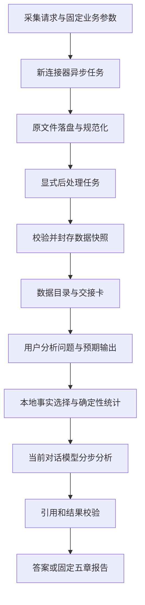

# 云图技能性能、后处理与对话分析优化路线图

日期：2026-09-07。状态：规划，尚未实施。代码基线：`d66cf73a5e331f787493936c4d2d3ed59974b193`。

前置：[连接器直接替换设计](2026-09-07-yuntu-details-connector-migration-design.md)、[迁移执行方案](../plans/2026-09-07-yuntu-details-connector-migration.md)。详细落地：[工作流实施契约](2026-09-07-yuntu-workflow-implementation-contract.md)、[工作流实施计划](../plans/2026-09-07-yuntu-performance-workflow-implementation.md)。依据：[全部提交历史审视与当前证据](../../handoffs/2026-09-07-yuntu-history-review.md)。

## 1. 规划结论

优先把技能整理为“采集与后处理有明确完成边界，数据交接可校验，AI 按用户问题消费同一份事实”的流程。在这个基础上减少重复 I/O、图片理解和无关模型上下文，再评估更激进的并发。

推荐渐进改造现有技能。保留已经形成的固定五章报告和客户分析逻辑，增加同一数据底座上的按需分析入口；不重新搭建一个平行采集框架，也不把元技能全部搬入当前仓库。

连接器上线后仍直接使用 `rpa.conn.juliang.yt.industry.content.rankings.details`，没有新旧切换开关或自动回退。以下优化按独立里程碑推进，不能让所有性能提案都成为新连接器上线的前置条件。

## 2. 历史审视带来的判断

本机全历史共 358 个可达提交，当前 HEAD 祖先 193 个；机械扫描全部补丁并建立完整索引，对工作流相关历史作语义深读。重复 patch-id 和历史快照不重复计算为业务需求，也不据提交主题推断实现状态。

已有能力应继续复用：三类榜单按依赖并发、详情波次并发、单素材一次 FFmpeg 批量抽帧、本地素材复用、CSV 规范化、章节事实包、模型输出校验、离线 Excel/ZIP。这些都不是本轮需要重新发明的优化。

需要优先处理的缺口：

1. `prepare-analysis` 仍补下载和抽帧，导致“分析准备”与数据后处理混在一起。
2. 本地历史实例中摘要为 12 素材、当前清单为 5 素材、目录有 17 个详情文件，且榜单和刷新的详情周期不同；缺少统一快照身份。
3. 最新五包共 4,178,441 字节，榜单和人群占 97.40%，仍要求一次生成完整分析；文件分包不等于按需供数。
4. 当前按整份报告组织 AI 交接，局部问题、局部失败和新对话续接缺少独立分析身份与恢复边界。

这些结论来自当前代码与本地文件，具体证据为历史审视 F1–F9。文件大小不等于实际 token；本次没有可比较的完整模型/后处理耗时测量，不承诺现成的提速百分比。

## 3. 用户流程：两阶段，但不增加无意义确认

### 3.1 阶段一：获取并准备数据

用户描述行业、周期、榜单和素材数量。技能解析一次采集参数，执行新 RPA、保存全部本次请求的原始与规范化数据，完成该任务要求的视频/高光等后处理，校验后返回数据交接卡。

“全部数据落盘”指本次任务声明的必需数据集和派生产物，不能理解为磁盘上所有历史文件，也不要求未请求的图片、视频或报告提前生成。

产品级选项为两类任务范围，不让用户填写内部状态机：

- **标准报告准备**：保留现有标准高光和完整报告所需数据，默认采集业务参数不变。
- **仅取数/文本分析准备**：只在用户明确要求该范围时，不下载视频、不抽帧；原始秒级曲线仍保留，不把关闭图片标成失败。

若客户已在第一句话明确要求完整报告并给出足够分析要求，阶段一交接校验成功后可以在同一次授权任务中继续阶段二。若用户只要求取数，则到交接卡停止；不为了实现“两阶段”强制所有任务再确认一次。

### 3.2 阶段二：用已落盘数据分析

客户继续描述自己的分析思路。技能先绑定数据快照，再判断所需事实、范围和可用证据，执行本地选择/统计，交给当前对话模型分析，最后输出答案或指定报告。

例如“只看这些素材的话术结构，按我给的三个角度分析”，应直接读取脚本事实及相应公式证据，不再次取数、不跑 FFmpeg、不读全部榜单或要求生成五章报告。

“只修改第三章结论”使用同一快照的新分析尝试；“换一个统计周期重新取数”是新采集任务，生成新数据集。系统不能把分析中的品牌/素材筛选自动写回 RPA 参数。

### 3.3 跨对话接续

同对话通过最近一次明确交接绑定快照；新对话读取用户提供的交接文件。存在多个候选批次且用户只说“刚才那批”时，展示简短候选摘要请求确定，不能按目录修改时间猜测。

交接信息应足以让新对话启动，不依赖前一对话的长上下文、临时 URL、工具内部 session 或人工重述文件名。

## 4. 建议内部结构与完成状态



没有图片需求时，P 记录 not_requested 后直接进入快照校验。模型视觉观察属于 A，是有来源的 AI 结果，不应伪装成 RPA 原始事实。

| 层级 | 身份 | 状态用途 |
| --- | --- | --- |
| 采集 | runId + collectionContract | pending/running/partial/success；继承迁移方案 v4 任务账本 |
| 后处理 | materialId + sourceHash + processingSpecHash | video/frame 各自 pending/running/succeeded/failed/not_requested |
| 数据交接 | datasetId + snapshotId | building/ready/invalid；表示具体不可变输入集合 |
| 一次分析 | analysisId + snapshotId + intentHash | awaiting_selection/ready/running/partial/failed/completed |
| 输出交付 | reportId + analysisId + renderVersion | building/failed/completed |

不以一个 success 字段同时代表所有层级。部分采集可以封存为范围明确的 partial snapshot，但不能满足要求完整采集的任务；应在每个分析请求进入时按其 requiredCapabilities 判断能否分析。

ready_for_analysis 是针对当前任务能力的判断：文本问题可以只要求脚本/榜单；视觉问题必须有相应帧或经验证可复用的观察；完整五章报告继续执行原完整门槛。缺少必需证据时返回具体缺口，不能通过关闭门槛伪装 ready。

## 5. 里程碑与依赖

| 阶段 | 优先级 | 目标与交付 | 依赖 | 验收重点 |
| --- | --- | --- | --- | --- |
| M0 新连接器可靠采集 | P0 | 按已有 8 任务迁移方案直接替换，异步账本、身份周期、原始文件/normalized 完整 | 正式上线 | 迁移 A1–A11 |
| M1 后处理边界与数据快照 | P1 | postprocess/retry-postprocess、只读 prepare-analysis、快照/交接卡、阶段计时 | 接入 M0 契约；离线设计可提前 | 分析阶段零网络/零 FFmpeg/源数据零写入；状态及素材数一致 |
| M2 用户问题到受限事实 | P1 | 能力目录、分析意图、白名单本地取数、分析身份与续接入口 | M1 | 同快照多问题不重采；引用可解析；模型输入只含所需证据 |
| M3 AI 增量与分步恢复 | P2 | 逐帧观察、按素材/章节 checkpoint、局部修复、最终兼容组装 | M2 | 单项失败不重做成功项；完整报告质量门槛不降 |
| M4 经过测量的资源优化 | P2 | 单帧复用、缓存指纹、波次等待实验、CPU/内存/磁盘限额 | M1 遥测；M0 稳定 | 同事实同输出条件下比较资源与 wall time |
| M5 交付与长期回归 | P2 | 按需答案、完整报告打包缓存、跨对话回放场景 | M2/M3 | 旧报告兼容；Excel/ZIP 完整；渲染失败不重跑模型或 RPA |

推荐实施顺序：先 M0；M1 的契约/测试设计可同步准备；M1→M2 完成后再做 M3。M4 的收益必须测量，不将“并发越高”作为结论。M5 中简单答案与完整报告的分流可随 M2 先落地。

本规划不估算缺少基准的开发人日和性能百分比。各阶段单独形成可审查 diff 和验收记录；不用一次大重构合并所有风险。

## 6. M1：RPA 后处理与不可变交接

### 6.1 显式后处理

从 `prepare_analysis()` 移出 `details_missing_standard_highlights / generate_standard_highlights_for_detail / write_highlights_manifest` 的副作用，集中到一个后处理协调器。首次采集、续跑和 retry-postprocess 都调用它；分析与渲染不能隐式启动该协调器。

后处理分项记录规范化校验、视频落盘、选点、截帧、帧校验、能力统计。normalize 仍紧随原始文件落盘且属于数据准备，视频/帧是可选派生能力。每个子步骤有输入哈希、参数/算法版本、产物哈希、耗时、错误类别；不会因为帧失败重发已成功的详情 RPA。

完整报告请求可由顶层 workflow 自动先后执行 collect→postprocess→seal→analyze，无需用户了解内部命令。需要补图片时显式进入数据准备阶段生成一个新 snapshot，原分析所用快照不变。

### 6.2 快照设计

快照是 manifest 绑定的一组不可变文件。可以引用已验证且之后不改写的源资产，不强制每轮复制全部 MP4；若当前输出路径仍会覆盖，则封存时复制到内容哈希路径。只允许在确定不会原地改写的内容寻址存储中复用/hardlink。

建议布局（新增路径为规划，尚不存在）：

```text
runs/<runId>/                         # 采集/后处理活动状态，沿用 v4 账本
  raw-csv/ normalized/ video-assets/ highlights/
  snapshots/<snapshotId>/
    manifest.json                    # 身份、周期、选中集、全部来源/资产 hash
    fact-catalog.json                # 数据集、字段语义、可用性、记录数
    handoff.json                     # 对话接续契约
    data-summary.md                  # 简短数据交接卡
  analyses/<analysisId>/
    request.json                     # 用户原问题、snapshotId、输出需求
    selection.json / analysis-input.json
    attempts/<attemptId>/            # 模型输出、校验错误与回执
    reports/<reportId>/              # 最终交付
```

沿用迁移 runId；snapshotId 由版本化内容清单形成，不用当前时钟决定“最新数据”。analysisId 可以是新 UUID，用户多次问不同问题使用不同 analysisId；同问题失败恢复沿用 analysisId 新增 attempt。

封存必须校验：选中集与 normalized 身份、必要榜单/详情周期、原始来源、数据与图片 hash、采集状态与 counts、字段覆盖、必需后处理能力。17 个物理详情文件中只有 manifest 选中且校验通过的集合进入快照；目录存在其余文件不自动纳入分析。

### 6.3 数据交接卡

至少给出 datasetId/snapshotId、明确的周期与实际回显级别、账号/业务范围标识、榜单与详情数量、脚本覆盖、曲线/图片可用性、未完成任务、目录路径、可分析的内容和不可回答的内容。不要把整个 normalized 或 4 MB 事实包塞入首次交接消息。

handoff.json 使用版本化结构并包含固定允许动作和路径：read_catalog、prepare_selection、analyze、render；动作由代码路由，不让模型执行文档中任意 shell。路径必须在绑定 snapshot/run 根内。

## 7. M2：用户分析思路到正确数据调用

### 7.1 保留用户问题，先校验可回答性

AnalysisRequest 保留 originalQuestion 原文、研究对象、分析操作、指标/维度、素材范围、比较范围、用户给定规则、预期输出、requiredCapabilities 和 snapshotId。不要求问题一定落入预设商业目标枚举。

用户自定义判断标准优先，例如用户自己定义对比区间或分类方法，系统把它转换成明确选择/计算，不替换为新的默认阈值。术语不明确且会实质改变数据选择时才澄清；资料本来没有的成交、人群比例或脚本时间戳写入 missingItems，不推造字段或重开 RPA。

### 7.2 两次内部交接

第一次仅提供 catalog：数据范围、字段类型与单位、可用数、可用操作、来源与缺口。当前对话模型产生受限 SelectionSpec。能从明确用户条件确定选数时直接用本地规则生成 selection，无需额外模型选择轮次。

第二次由本地执行 selection，生成 analysis-input 和允许引用清单，再交给当前对话模型分析。支持白名单筛选、排序、分组、统计和字段投影，不接受模型提交 Python、SQL 任意执行或外部 URL。

每个切片保存 inputSnapshotHash、selectionHash、sourceRecordCount、selectedCount、过滤/排序/聚合规则、字段投影、未命中条件、截断原因和 sourceRefs。使用原始快照记录位置建立引用，不用切片内索引冒充原始行号。

引用契约建议拆为 `{snapshotId, path, pointer}` 三字段；path 来自快照 catalog 白名单，pointer 为原始不可变文件的 JSON Pointer。聚合事实另有 aggregateRef，绑定算法、参数和完整参与源集合，不能把多个素材聚合结果归到一条素材行。

### 7.3 全量统计与模型输入分离

TOP1000 统计仍在本地全量计算，不能为省 token 改成 Top100 或只分析详情素材。模型只接收所需全量聚合、用户指定素材与可回查的证据行；发现证据不足可分批追加本地切片，不能静默截断后称“覆盖全量”。

榜单、人群、脚本、视觉分开投影；用户只问脚本时模型请求的榜单/人群数组和图片数应为 0。对需要所有素材逐一解释的明确请求，分页或分步完成全部覆盖，不能为了预算漏掉尾部素材。

压缩先以字段与选择准确性为准。每次记录实际输入字节、可得时的 token、图片数和输出覆盖；具体默认预算在基准后确定，不在此强加同系技能的“100 行”上限。

### 7.4 同系技能复用方式

参考本地 yuntu-meta-skill 的 FactCatalog、FactSelectionSpec、canonical 引用校验与宿主交接。先做路径/schema/字段单位/品牌归属/状态/错误语义兼容矩阵，再复用中性契约、验证函数和回归场景。

不直接复制其 QuerySpec 默认值、候选池 1000、预置 objective 或报告逻辑。本技能已拥有三类榜单和五章业务边界，仍是该业务的权威。暂不引入跨仓库远程服务或公共包发布，避免迁移之外增加运行依赖。

## 8. M3：数据落盘后的 AI 分步与恢复

### 8.1 保留同一宿主模型，拆分工作单元

当前 single_model_call 是一次完整报告输出契约。后续增加显式 staged_model_analysis 版本，旧 receipt/历史报告继续按原规则读；不能只在脚本中偷偷多调模型而仍声明一次调用。

工作单元按依赖拆分：确定性统计准备；必要 JPEG 的逐帧观察；当前素材脚本分析；章节聚合/品牌与批次结论；最终报告 JSON 组装。全部由当前对话模型通过宿主交接完成，继续禁止 codex exec、外部模型子进程或程序模板替代业务结论。

是否由宿主并行调度多个独立模型工作单元不在本轮默认启用。先验证串行分步的状态、引用与恢复，再评估并行收益与用户授权。

### 8.2 视觉观察缓存

逐帧视觉观察使用 JPEG 内容 hash、观察 schema/prompt 版本、模型标识（宿主能提供时）和原 frameRef 记录来源。它是 model_observation，不是 raw_fact。只有实际读取成功图片并通过字段检查的结果可复用；generator 自填字符串不能证明模型实际看过图片。

可验证时，第四章分类和第五章单帧展示共享同一视觉观察基础；各章节独有的推理与表述仍独立生成，不要求展示文案机械相同。新批次分类按当前集合重新聚合，不能直接拿旧批次动态分类替代。

缓存命中只减少重复观察，不绕过图片/事实变化检查或当前业务问题所需的新分析。模型版本不可确认时保留 unknown 和适用限制，不宣称得到可复现的跨模型缓存。

### 8.3 局部失败与组装

每个工作单元保存 inputHash、outputSchemaHash、outputHash、status、attempt 和 validationErrors。单素材失败只重做该素材，章节证据变更只失效其依赖单元。最终组装使用通过校验的输出，不通过全局文本重写把失败项掩盖成完整结果。

用户只改分析角度，保留同一原始事实；是否复用已有结论必须匹配 intentHash 和依赖，而不是仅匹配素材 ID。schema 合法但内容空泛、证据错位仍不通过原内容质量检查。

移除五类指数的模型自然语言解释是既有业务决定。完整曲线仍进入报告确定性数据，默认不重复送进无此任务的模型输入；用户另有明确问题时通过按需切片处理，不恢复固定模板里已删除的指数分析。

## 9. M4：后处理性能与调度优化

### 9.1 先做不改变业务语义的优化

- 复用现有单素材 FFmpeg 批量抽帧；缓存完整性按单帧检查，只抽缺失/无效的帧，不因缺一帧重做完整集合。
- 每批只加载一次高光 manifest，在主线程维护索引；避免每个素材复用检查再次完整读取 manifest。
- 视频缓存绑定 materialId、原始视频内容 hash；选点与帧绑定曲线/策略/提取版本。相同素材 ID 不足以证明同内容或同选点策略。
- 下载、解码、单帧校验、批量回退分别记录错误；不要把整个 _material_frames 异常都归为 download_failed。
- 批量失败后仍保留现有逐帧恢复能力，但记录 fallback 次数和额外进程数，以判断失败回退是否抵消了批量收益。
- 统一输入准备中重复使用的品牌分组、scope 聚合索引，先 profile 再决定复用缓存，避免未经测量重写分析算法。

### 9.2 波次屏障的两个后续候选

迁移 M0 保留现有屏障。之后若历史约束允许重新评估，比较：

| 方案 | 行为 | 主要收益/代价 |
| --- | --- | --- |
| 保留屏障 + 增量后处理 | 仍整波结束后下一波 | 语义最稳；慢素材仍可能阻塞 |
| 有界流水线 | 每条详情落盘即进入后处理队列，RPA 有空位继续补入 | 减少网络与 CPU 互等；需队列上限、内存/磁盘背压、候选数量与取消策略 |
| 采集后集中处理 | 先全部详情落盘，再批量后处理 | 数据落盘时点更清晰；更晚得到第一张帧，且总耗时不一定最短 |

推荐先交付第一种，实测波次等待占比后，再选择后两种之一做隔离实验。不能在未重新确认原波次约束的情况下直接上线有界流水线。纯数据模式无需经过帧屏障，但必须是用户明确选择的任务范围。

并发限制分别覆盖网关在途任务、下载、解码、模型输入，不共用一个“并发数”。不建议直接把当前 3 提高到 10，也不引入常驻 worker、消息队列或分布式服务来优化当前小批量本地工作流。

## 10. M5：分析结果与交付解耦

按需问题默认交付有引用的回答/Markdown，仅当用户要完整报告时才执行五章组装、图片/视频复制、Excel 和 ZIP。完整报告必须继续自动包含 Excel，不能恢复历史上已被替换的“用户另行执行导出命令”体验。

纯布局修改只重渲染；Excel 或 ZIP 失败只重做对应交付步骤；不重跑 RPA 或 AI。资产文件 hash、analysisHash、renderVersion 一致时可复用已有可验证产物，变化时只重建相关部分。

每次报告独立 reportId，在 staging 目录完成验收后发布到最终目录，避免用户看到一半新一半旧的 HTML/Excel/资源。保留旧报告版本，不覆盖已交付文件。

## 11. 性能和流程验收指标

### 11.1 先测量，再设速度目标

分阶段记录 submit/query/download/normalize/video_download/frame_extract/frame_validate/build_facts/build_selection/model_wait/model_generation/validate/render/excel/zip 的 wall time、尝试数、重用数、输入输出字节。并发阶段分别记录跨度和任务耗时，不能把所有 worker duration 之和冒充端到端耗时。

宿主没有 token/首 token 时间/模型耗时接口时标 unavailable；目录 mtime、commit 时间和 generator 字符串不作为替代。初步样本量小先报逐次结果/中位数/范围，达到足够样本后才讨论 p95。

| 场景 | 必须满足的流程指标 | 性能比较方式 |
| --- | --- | --- |
| 同快照再次问纯文本问题 | RPA 提交=0、视频下载=0、FFmpeg=0 | 对比当前完整报告输入与按需切片字节及可得 token |
| 只分析脚本 | 其他业务数据/图像不进入模型输入，除非用户要求关联 | 保持脚本覆盖与引用，比较模型输入规模 |
| 单帧缺失 | 仅恢复失效帧，详情 RPA=0 | 进程数、抽帧数、热缓存耗时 |
| 单素材 AI 失败 | 其他成功素材不重跑 | 失败恢复新增模型单元数及时间 |
| 新对话继续同批 | snapshotId 正确、无需扫描所有原 CSV、无采集提交 | 首次可分析输入准备步骤与耗时 |
| 只修改报告布局 | RPA=0、模型生成=0 | 渲染/Excel/打包各阶段耗时 |
| 同名素材换内容/策略 | 旧缓存不误命中 | 失效范围及新产物正确性 |

### 11.2 回归矩阵

至少覆盖：全量成功、详情部分失败、纯数据无图片、图像失败但文本可用、源 CSV 重复/冲突、不同周期同素材、状态摘要漂移、缺文件/hash 变化、无脚本、用户多问题、跨对话续接、选择为空、越界引用、聚合引用、模型局部失败、渲染中断、历史旧格式。

所有离线回放在临时副本或新目录执行，原样本/执行日志/历史报告前后 hash 不变。新连接器线上验证使用迁移方案的实际任务证据，不用 mock 完成态替代。

## 12. 实施文件与推荐首批工作

| 工作单元 | 主要落点 | 首批验收 |
| --- | --- | --- |
| 后处理统一入口 | yuntu_batch.py、yuntu_highlights.py；必要时新增 yuntu_postprocess.py | prepare_analysis mock 网络/FFmpeg 为异常时仍能只读构建已有事实 |
| 快照与阶段就绪 | yuntu_run_state.py、yuntu_analysis_provenance.py | 12/5/17 状态反例被识别，不自动修写原目录 |
| 分析交接入口 | rpa_connector.py、SKILL.md；必要时新增 yuntu_analysis_workflow.py | collect_only 停止；明确全报告请求可自动连续推进 |
| 目录与取数 | 适配同系 FactCatalog/Selection 契约，复用当前 normalized 事实 | 同快照脚本问题不传全榜单，所有引用落到原始位置 |
| AI 单元与组装 | yuntu_analysis.py、provenance、report validator | 旧 single_model_call 可读，新 staged 模式明确声明 |
| 交付缓存 | yuntu_report.py、yuntu_highlight_export.py | 完整报告含 Excel/ZIP，渲染恢复不触发上游 |

建议下一批只做 M1：明确后处理命令、移除分析准备的隐藏副作用、快照交接和计时。这一批能直接解决“数据已经落盘，为什么分析还在下载/抽帧”和“后续对话究竟用哪批数据”两个问题，同时为 M2/M3 提供可靠输入。

M1–M5 的接口、文件职责、任务顺序、测试和交接提示词已见[工作流实施契约](2026-09-07-yuntu-workflow-implementation-contract.md)与[工作流实施计划](../plans/2026-09-07-yuntu-performance-workflow-implementation.md)。M3 分步模型调用、M4 放开波次屏障都是明确的行为变更，要单独验证；不能因本规划提出就视为已修改既有约束。

## 13. 完成与交付状态

本次已产出全量提交索引、历史/现状审视、真实本地文件证据和本路线图，并修正迁移文档的列表并发依赖描述。没有实现上述优化，没有更改业务代码、源运行数据、AI 分析或历史交付。

下一次实施应从明确里程碑开始，保留客户原有商业分析思路和原产物，逐项给出改动、测试、真实运行及可量化收益；不能只以代码行数下降、文件更少或单次成功状态认定优化完成。
