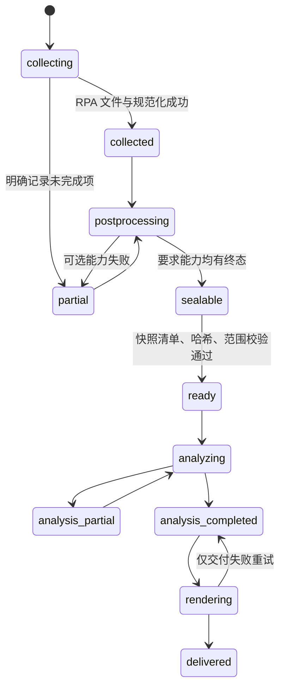

# 云图取数后处理与分析工作流实施契约

日期：2026-09-07。状态：设计冻结，尚未实现。代码基线：`d66cf73a5e331f787493936c4d2d3ed59974b193`。

本文件把[性能、后处理与对话分析优化路线图](2026-09-07-yuntu-performance-workflow-roadmap.md)转为实现契约。连接器直接替换仍由[连接器迁移设计](2026-09-07-yuntu-details-connector-migration-design.md)和对应执行方案单独负责；本契约不修改连接器、不会重新提交历史 RPA。

## 1. 实施边界和固定决策

目标是把一次采集形成一份可验证、可跨对话复用的数据快照；取数后的下载、抽帧与事实准备在明确阶段完成；后续问题只从该快照选择事实并由当前对话模型分析。保留现有五章报告、Excel、离线 HTML/ZIP 和客户已有的商业分析思路。

以下决策已固定，实施者不得自行改成其他行为：

| 主题 | 固定决策 |
| --- | --- |
| 连接器 | M0 上线后详情仅使用 `rpa.conn.juliang.yt.industry.content.rankings.details`；没有双写、回退或新旧数据混跑。 |
| 采集与分析 | 分析绝不提交 RPA、下载视频、调用 FFmpeg 或改写源 run；数据缺口返回 `gaps`。 |
| 快照 | 一个 `snapshotId` 对应一组经哈希验证的清单，封存后只读；补后处理生成新快照。 |
| 历史数据 | 只读适配。历史目录有多批文件时，只有 manifest 明确选中且校验通过的文件能入快照。 |
| 用户逻辑 | 不添加默认商业目标、阈值、评分或人群结论；用户规则只转化为选择和本地计算规则。 |
| 模型 | 仅通过当前宿主对话完成分析；禁止 `codex exec`、外部模型子进程和程序化商业结论兜底。 |
| 交付 | 简单问题交付带引用的回答；完整报告仍生成五章、Excel、HTML、视频/图片资源和 ZIP。 |
| 并发 | M0 保留详情/高光整波屏障与并发 3；放开屏障只可作为 M4 独立实验。 |

术语：**run** 是有 RPA 生命周期的目录，**source artifact** 是 raw/normalized/媒体文件，**snapshot** 是不变的分析输入集合，**analysis** 是同一快照上的一次用户问题，**attempt** 是同一分析的单次模型尝试，**report** 是一次渲染交付。

## 2. 目录、所有权与不变性

在既有 `runs/<runId>/` 或当前批次目录内增加下列目录。实施前先通过适配层把旧根目录映射为 `runRoot`，不要移动历史文件。

```text
<runRoot>/
  raw-csv/                         # 采集器唯一写入者
  normalized/                      # 规范化器唯一写入者
  video-assets/ highlights/        # 后处理器唯一写入者
  batch-manifest.json run-summary.json
  snapshots/<snapshotId>/          # 封存器唯一写入者；完成后只读
    manifest.json
    fact-catalog.json
    handoff.json
    data-summary.md
  analyses/<analysisId>/           # 分析工作流唯一写入者
    request.json
    selection.json
    analysis-input.json
    attempts/<attemptId>/
      request.json output.json validation.json receipt.json
    reports/<reportId>/             # 渲染器 staging 校验后发布
```

任何持久化 JSON 都使用现有 `write_json_atomically()` 或 `save_run_state()` 的临时文件加 `os.replace` 方式。一个 run 在同一时刻只允许一个写入流程：新命令创建 `<runRoot>/.workflow.lock`，内容为 `{schemaVersion, operation, ownerId, startedAt}`；文件存在且 owner 未明确终止时，命令失败并提示先运行只读 `status`。锁只能由创建它的成功/失败清理逻辑删除，不能在分析时为了“恢复”删除。

原始文件和活动目录允许继续产生新产物；快照清单所引用的每个文件均记录路径、大小和 SHA-256，分析前必须再次验证。若现有路径可能被后续流程覆盖，封存器先复制到 `snapshots/<snapshotId>/assets/<sha256>-<basename>`；只有内容寻址且永不覆盖的文件允许 hard link。禁止引用快照根以外的相对路径、符号链接或空文件。

## 3. 身份、状态和错误码

### 3.1 身份计算

`runId` 沿用 M0 的 collection run ID。以下 ID 的输入以 UTF-8、JSON key 排序、紧凑分隔符序列化，再取 SHA-256 前 24 位；同一输入必须得到同一 ID。

```python
def stable_id(prefix: str, payload: dict) -> str:
    encoded = json.dumps(payload, ensure_ascii=False, sort_keys=True,
                         separators=(",", ":")).encode("utf-8")
    return f"{prefix}-{hashlib.sha256(encoded).hexdigest()[:24]}"
```

| ID | 输入 | 用途 |
| --- | --- | --- |
| `snapshotId` | `schemaVersion`、runId、collection contract hash、所选榜单/详情/媒体 artifact 的 `{path,sha256}`、postprocess spec hash | 同一事实集合复用，内容变化必变。 |
| `analysisId` | 新 UUID，不从问题文本推导 | 区分每次用户问题；同问题失败重试沿用。 |
| `intentHash` | `originalQuestion`、`requestedOutput`、`userRules`、`materialScope`、`comparisonScope`、`requiredCapabilities` | 判断旧模型结论是否可复用。 |
| `attemptId` | 新 UUID | 每次模型/校验尝试的审计边界。 |
| `reportId` | `stable_id("report", {analysisId, analysisOutputHash, renderVersion})` | 相同可验证结果可复用，不覆盖不同渲染版本。 |

所有时间字段为 UTC ISO-8601 字符串；展示可另转上海时区。绝不能以目录名、mtime 或“最近一批”推断快照身份。

### 3.2 状态图和允许转移



`failed` 只能表示当前操作未完成，必须附带 `errorCode`、`message`、`failedAt` 和 `retryable`。使用以下固定错误码：`source_missing`、`source_hash_mismatch`、`source_outside_root`、`collection_incomplete`、`context_mismatch`、`capability_missing`、`selection_invalid`、`reference_invalid`、`model_output_invalid`、`render_failed`、`lock_held`。不要把“没有脚本”“没有帧”“用户条件无匹配”登记成系统异常，分别写 `source_empty`、`field_missing`、`selection_empty` 到 `gaps`。

## 4. M1：显式后处理、快照与交接

### 4.1 后处理契约

新增 `scripts/yuntu_postprocess.py`，只有该模块可以触发视频下载和抽帧。`prepare_analysis()` 必须变成纯读取：它不得导入、调用或间接触发 `generate_standard_highlights_for_detail()`、`download_video()`、`extract_frame()`、`extract_frames_batch()`、`write_highlights_manifest()`。

```python
@dataclass(frozen=True)
class PostprocessRequest:
    run_root: Path
    material_ids: tuple[str, ...]
    mode: Literal["standard_report", "data_only"]
    processing_spec: dict

@dataclass(frozen=True)
class PostprocessResult:
    status: Literal["succeeded", "partial"]
    material_results: dict[str, dict]
    capabilities: dict[str, dict]
    timings_sec: dict[str, float]

def postprocess_run(request: PostprocessRequest, *, downloader=download_video,
                    batch_extractor=extract_frames_batch) -> PostprocessResult: ...
def retry_postprocess(run_root: Path, *, material_ids: tuple[str, ...] | None = None) -> PostprocessResult: ...
```

`standard_report` 为每个已选详情执行：校验 normalized detail → 确定 `sourceHash` → 找到或下载视频 → 使用已有 `cover_plus_click_top5` 选点 → 批量抽帧 → JPEG 校验 → 写入高光和视频记录。`data_only` 不下载、不抽帧，每个素材的 video/frame 状态为 `not_requested`，不是失败。

每个素材记录在 `batch-manifest.json.selectedMaterials[*].postprocess`：

```json
{
  "status": "succeeded",
  "sourceHash": "sha256:...",
  "processingSpecHash": "sha256:...",
  "video": {"status": "succeeded", "path": "video-assets/101.mp4", "sha256": "..."},
  "frames": {"status": "succeeded", "requested": 4, "available": 4,
             "recordsPath": "highlights-manifest.json"},
  "timingsSec": {"videoDownload": 1.2, "frameExtract": 0.4},
  "error": null
}
```

状态只能是 `pending`、`running`、`succeeded`、`failed`、`reused`、`not_requested`。重试仅处理 `failed` 或 hash/spec 不匹配的素材；绝不重发详情 RPA。下载错误、批量解码错误、单帧回退错误和 JPEG 无效分别记入 `errorCode`，不得统一写成 `download_failed`。

### 4.2 快照 schema

新增 `scripts/yuntu_snapshot.py`，它只依赖 run-state、normalized 数据和后处理清单，不能调用网络或 FFmpeg。

```python
def seal_snapshot(*, run_root: Path, required_capabilities: set[str],
                  output_dir: Path | None = None) -> Path:
    """Validate selected source artifacts and atomically publish one snapshot directory."""

def load_verified_snapshot(snapshot_root: Path) -> dict:
    """Return manifest after containment, size and SHA-256 verification."""

def build_fact_catalog(snapshot: dict, run_root: Path) -> dict: ...
def build_handoff(snapshot: dict, catalog: dict) -> dict: ...
```

`manifest.json` 的最小结构如下。字段名为 camelCase；hash 使用小写十六进制且不带 `sha256:` 前缀。

```json
{
  "schemaVersion": 1,
  "snapshotId": "snapshot-...",
  "runId": "...",
  "status": "ready",
  "createdAt": "2026-09-07T00:00:00Z",
  "collectionContractHash": "...",
  "selectedMaterialIds": ["101", "102"],
  "sourceArtifacts": [
    {"kind": "normalized_detail", "materialId": "101",
     "path": "normalized/detail-records/101.json", "sizeBytes": 123,
     "sha256": "...", "requiredBy": ["text_analysis", "standard_report"]}
  ],
  "capabilities": {
    "ranking": {"status": "available", "recordCount": 1000},
    "detail": {"status": "available", "recordCount": 2},
    "script": {"status": "partial", "availableCount": 1, "missingMaterialIds": ["102"]},
    "visual": {"status": "available", "availableCount": 8, "missingMaterialIds": []}
  },
  "gaps": [],
  "provenance": {"normalizationVersion": 2, "postprocessSpecHash": "..."}
}
```

允许能力为 `ranking`、`detail`、`script`、`visual`、`standard_report`。`standard_report` 要求 ranking/detail/visual 都为 `available` 且 collection 不存在未解决的必需详情；文本问题可接受 script 为 `partial`，但问题范围若点名缺脚本素材则返回该素材缺口。`seal_snapshot` 发现所需能力不满足时不创建 `ready` 快照，抛出包含具体 `gaps` 的 `YuntuSnapshotError`。

### 4.3 目录和交接卡

`fact-catalog.json` 只描述可选事实，不能塞入完整事实包。每个 dataset 结构为：

```json
{"datasetId":"detail_materials","path":"normalized/detail-records",
 "recordCount":2,"recordIdentity":"material_id","fields":[
   {"name":"script_text","type":"string","unit":null,"availability":"partial"},
   {"name":"trend_series","type":"object","unit":"per_second","availability":"available"}
 ],"allowedOperations":["filter","project","group","aggregate","sort"],"sourceRefs":[...]}
```

`handoff.json` 只允许 `read_catalog`、`prepare_selection`、`analyze`、`render_report` 四个 action。它包含 snapshotId、绝对 snapshotRoot、数据范围、capabilities、gaps、可用 action 和一个短 `resumePrompt`。`data-summary.md` 是面向用户的交接卡：周期回显级别、选中详情数、脚本/帧覆盖、未完成项、快照路径和可回答/不可回答的问题。不得将原始 CSV、fileUrl、凭证、完整模型事实包写入交接卡。

## 5. M2：用户问题、事实选择和受限输入

### 5.1 请求和选择 schema

新增 `scripts/yuntu_analysis_workflow.py`。该模块读取快照，执行本地选择，创建分析 attempt；它不能调用 `rpa_connector`、`yuntu_postprocess` 或媒体函数。

```python
def create_analysis_request(*, snapshot_root: Path, original_question: str,
                            requested_output: Literal["answer", "full_report"],
                            user_rules: list[dict] | None = None,
                            material_scope: dict | None = None,
                            comparison_scope: dict | None = None) -> Path: ...
def validate_selection_spec(spec: dict, catalog: dict) -> dict: ...
def execute_selection(*, snapshot_root: Path, analysis_root: Path, spec: dict) -> dict: ...
def validate_analysis_references(output: dict, allowed_fact_refs: list[dict]) -> list[dict]: ...
```

`request.json` 至少有：`schemaVersion`、`analysisId`、`snapshotId`、`originalQuestion`、`requestedOutput`、`userRules`、`materialScope`、`comparisonScope`、`requiredCapabilities`、`intentHash`、`createdAt`、`status`。解析不清且影响素材/周期选择时状态为 `awaiting_selection` 并返回候选信息；不能默选 mtime 最新目录。

模型或本地规则给出的 `SelectionSpec` 必须符合以下封闭格式，未知 key 拒绝：

```json
{
  "schemaVersion": 1,
  "snapshotId": "snapshot-...",
  "datasets": [
    {"datasetId": "detail_materials",
     "filter": [{"field":"material_id","operator":"in","value":["101"]}],
     "projection": ["material_id","title","script_text","content_formula.sources.script"],
     "sort": [],
     "aggregates": []}
  ],
  "rationale": "用户指定素材并要求分析话术结构"
}
```

允许 filter operator 仅为 `eq`、`in`、`not_in`、`contains`、`exists`、`is_empty`、`gte`、`lte`；数值字段才允许 gte/lte。`sort` 仅允许 `{field, direction}`，direction 是 `asc`/`desc`。聚合仅允许 `count`、`sum`、`avg`、`min`、`max`、`median`、`percentile`，并须给出 `field`（count 可为 null）、`groupBy`、`alias`。不存在的字段、越过 catalog path、任意代码、SQL、URL 和未定义操作均以 `selection_invalid` 拒绝。

### 5.2 引用与分析输入

事实引用的唯一格式是：

```json
{"snapshotId":"snapshot-...","path":"normalized/detail-records/101.json",
 "pointer":"/script_text"}
```

`path` 必须与 snapshot manifest 某一 artifact 精确相同；`pointer` 是 RFC 6901 JSON Pointer，必须在该 JSON 文档存在。聚合引用另用：

```json
{"aggregateRef":"aggregate:script_count_by_brand","algorithm":"count",
 "parameters":{"field":"material_id","groupBy":["brand"]},
 "sourceRefs":[{"snapshotId":"...","path":"...","pointer":"/material_id"}]}
```

`analysis-input.json` 包含 `schemaVersion`、snapshotId、analysisId、inputSnapshotHash、selectionHash、sourceRecordCount、selectedCount、facts、`allowedFactRefs`、`aggregateRefs`、`gaps`、`metrics`。`facts` 只放 projection 和本地聚合结果；不得写入全量报告数据后再要求模型“忽略无关内容”。全量 TOP1000 的统计必须先在本地完整执行，输出聚合数值与参与范围；用户明确要求逐素材覆盖时，按页面/单元分批直至全部完成，记录 continuation 而不是静默截断。

分析输出中每一条可核验结论需有 `factRefs`；`validate_analysis_references` 必须验证每个 ref 属于 `allowedFactRefs` 或 aggregateRefs。输出写入 `attempts/<attemptId>/output.json` 前先校验 schema 与引用，失败写 `validation.json`，不覆盖已通过 attempt。

## 6. M3：分步模型与可恢复分析

旧 `analysis-unit-manifest.json` 的 `executionMode=single_model_call` 保持可读。新增 `executionMode=staged_model_analysis` 后，provenance 校验必须按 mode 分支，不能让 staged 文件伪装为单次模型调用。

新 manifest 最小结构：

```json
{"schemaVersion":2,"executionMode":"staged_model_analysis","analysisId":"...",
 "snapshotId":"...","units":[
  {"unitId":"visual:frame:abc","kind":"visual_observation","dependsOn":[],
   "inputHash":"...","outputSchemaHash":"...","status":"succeeded",
   "attemptIds":["..."],"outputPath":"attempts/.../output.json","outputHash":"..."},
  {"unitId":"script:101","kind":"material_script","dependsOn":[],"status":"pending"},
  {"unitId":"chapter:script","kind":"chapter_synthesis","dependsOn":["script:101"],"status":"pending"}
]}
```

单位种类固定为 `visual_observation`、`material_script`、`chapter_synthesis`、`report_assembly`。每个单位保存 input hash、输出 schema hash、依赖 unit 输出 hash、status、attempt IDs、validation errors。依赖哈希变化才失效下游；用户改问题使 intentHash 变化时不复用业务结论，只能复用 input 不变且 schema/prompt/model 兼容的视觉观察。

视觉观察缓存键为 `{jpegSha256, observationSchemaHash, promptHash, modelIdOrUnknown}`。缓存结果类型为 `model_observation`，必须记录 `frameRef` 和原始 fact ref。`generator` 文本、文件名或 JPEG 路径不能证明模型查看过图片。当前模型 ID 无法获得时记 `unknown`；未知模型的缓存只能在相同 observation prompt/schema 下作为候选，交由当前 attempt 明示采用，不能声明跨模型可复现。

单素材或单帧失败时只创建该 unit 的新 attempt。`report_assembly` 只使用成功且经过引用校验的单位；缺单位时生成 `analysis_partial` 和明确 gaps，不能用全局重写补成“完整报告”。五章中已移除的五类指数自然语言解释不因分步流程而恢复；曲线仍作为确定性报告数据。

## 7. M4：缓存、调度和测量

M4 先落地不改变业务结果的缓存身份：视频缓存键为 `{materialId, videoSha256}`；帧缓存键为 `{materialId, sourceHash, processingSpecHash, second, frameType}`。`processingSpecHash` 必含标准选点版本、趋势字段、FFmpeg 参数和 JPEG 校验版本。缓存 hit 前检查文件在根内、非空、hash 一致及 JPEG SOI/EOI；仅缺失/无效帧进入提取。

增加 `workflow-timings.json`，每次操作记录 `operationId`、runId、snapshotId（已有时）、stage、startedAt、endedAt、wallTimeSec、outcome、attempt、itemCount、bytesRead、bytesWritten、cacheHitCount、cacheMissCount、errorCode。阶段枚举只限 `submit`、`poll`、`download`、`normalize`、`video_download`、`frame_extract`、`frame_validate`、`seal_snapshot`、`build_selection`、`model_wait`、`model_generation`、`validate`、`render`、`excel`、`zip`。

有界流水线不是本阶段默认实现。实验前必须在同一组冻结样本上保存屏障基线和候选实现记录，比较 wall time、最大在途数、峰值内存/磁盘、重试数、输出 hash 与帧清单。只有输出与基线一致、资源上限不超出实验配置、取消后无半成品发布时才可提议改动默认调度。

## 8. M5：交付解耦与恢复

`requestedOutput=answer` 只输出回答 Markdown/JSON、来源引用和 analysis receipt；不得调用 `render_report`。`requestedOutput=full_report` 在分析验证通过后调用现有渲染器，输出目录先为 `reports/<reportId>/.staging/`，完成 HTML、Markdown、presentation JSON、Excel、视频/帧资源、ZIP 的既有校验后才原子发布为 `reports/<reportId>/final-report/`。

渲染 receipt 至少记录 analysis output hash、fact input hash、renderVersion、所有交付文件 hash、状态和错误。仅模板/CSS 改动时创建新的 reportId 并重渲染；Excel/ZIP/HTML 的局部失败可仅重跑对应交付段；绝不能重跑 RPA、后处理或模型。旧报告不覆盖、不删除。

## 9. 兼容和验收矩阵

| 场景 | 必须结果 |
| --- | --- |
| 旧批次 `single_model_call` | provenance 和既有完整报告仍可读；不要求生成 snapshot。 |
| 12/5/17 混合目录 | seal 拒绝不由同一 manifest 选中且未校验的来源，给出 `context_mismatch`/`source_hash_mismatch`。 |
| data_only | 视觉为 `not_requested`，文本快照可 ready，下载/FFmpeg 调用次数为 0。 |
| 文本问题复用快照 | RPA/下载/FFmpeg 调用次数为 0；仅 catalog、selection 和模型 attempt 新建。 |
| 点名无脚本素材 | 结果为 `source_empty` 或 `field_missing` gap，不造脚本文本。 |
| 脚本问题 | analysis input 不含榜单、人群、visual assets，除非 SelectionSpec 明确选取。 |
| 篡改 artifact | `load_verified_snapshot` 在模型调用前拒绝。 |
| 越界引用 | selection 或输出校验拒绝，禁止读取快照外文件。 |
| 单帧/单素材失败 | 成功 unit 不重跑；分析为 partial 且列出缺口。 |
| 渲染中断 | 模型 attempt 保持可用；恢复渲染不触发上游。 |

这些测试在临时目录或复制 fixture 执行。真实 RPA 新连接器验证以迁移方案为准；当前本地混合历史样本不是性能基准，不能据此承诺速度比例。
