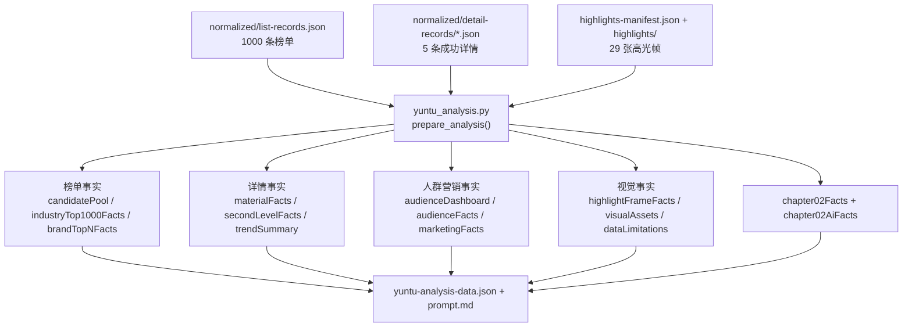
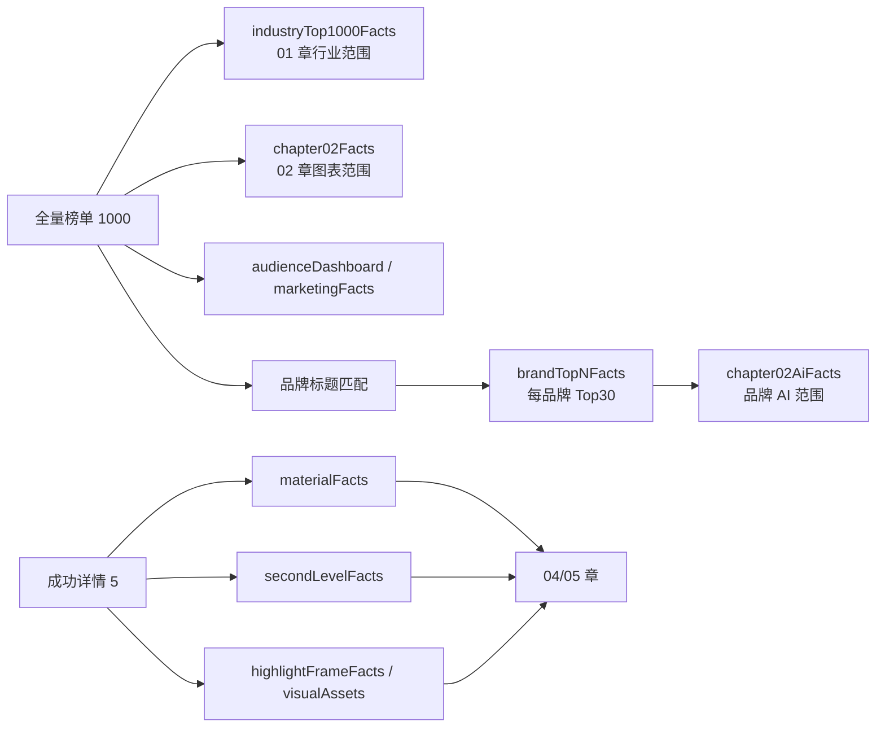

# 云图真实批次事实包生成溯源

## 分析对象

批次：`RPA数据汇总/yuntu-rankings-analysis-20260730-20260805-food-beverage-brands-top6-strict`

- 榜单规范化数据：1000 条
- 成功详情：5 条
- 详情失败：1 条，批次状态为 `partial`
- 高光帧：5 个素材，共 29 张可用帧
- 品牌 Top N：每品牌 30 条

## 执行链

## 顶层字段溯源

| 字段 | 生成函数/位置 | 输入范围 | 真实规模 | 主要消费者 |
|---|---|---|---:|---|
| `schemaVersion` | `prepare_analysis()` 固定值 | 无 | 4 | 所有下游 |
| `filters` | manifest 透传 | 本次运行参数 | 3 品牌、固定日期 | prompt、封面 |
| `selectedMaterials` | manifest 透传 | 成功详情 | 5 | report、presentation |
| `rejectedMaterials` | manifest 透传 | 失败详情 | 1 | report、限制说明 |
| `summaryMetrics` | `prepare_analysis()` | 三类计数 | 1000/5/1 | JSON、HTML |
| `candidatePool` | `_candidate_pool()` | 全量榜单 | 1000 | report |
| `reportScopes` | `_report_scopes()` | 榜单/详情/失败 | ranking=1000、detail=5 | AI、report |
| `topMaterialCombination` | `build_top_material_combination()` | 全量榜单 | 品牌 Top30 | AI、report |
| `audienceDashboard` | `build_audience_dashboard()` | 全量榜单 | 1000 | AI、report |
| `audienceTopNRecords` | `_audience_topn_records()` | 全量榜单 | 1000 | report sections |
| `tagInsights` | `_tag_insights()` | 全量榜单 + 成功 ID | 1000 + 5 | AI、report |
| `trendSummary` | `_trend_summary()` | 成功详情 | 5 | AI、report |
| `dataAvailabilitySummary` | `_availability_summary()` | material facts | 20 个缺失项 | AI、report |
| `materialFacts` | `prepare_analysis()` 主循环 | 榜单+详情+帧 | 5 | AI、presentation、report |
| `chapter02Facts` | `_chapter02_scope_fact()` | 全量榜单/品牌全量匹配 | all + 3 品牌 | 图表、presentation |
| `chapter02AiFacts` | `_chapter02_scope_fact()` | 全量榜单/品牌 Top30 | all + 3 品牌 | AI |
| `rankingFacts` | `_model_input_sections()` | 成功素材事实 | 5 | AI |
| `industryTop1000Facts` | `_ranking_scope_facts()` | 全量榜单 | 1000 | AI、report 校验 |
| `brandTopNFacts` | `build_top_material_combination()` + `_ranking_scope_facts()` | 标题匹配后的品牌素材 | 3×30 | AI、report 校验 |
| `audienceFacts` | `_model_input_sections()` | 人群 dashboard + 成功素材标签 | dashboard=1000、materials=5 | AI |
| `marketingFacts` | `_model_input_sections()` | 标签统计 + 成功素材标签 | 全量 + 5 | AI |
| `secondLevelFacts` | `_model_input_sections()` | 五类详情趋势 | 5 | AI、presentation |
| `highlightFrameFacts` | `_model_input_sections()` | 帧 manifest | 29 | AI、report |
| `visualAssets` | `_model_input_sections()` | 帧 manifest | 29 | AI、report |
| `dataLimitations` | `_data_limitations()` | 列表/详情/帧可用性 | 20 | AI、report |

## 核心计算链

### 榜单

文件：[scripts/yuntu_analysis.py](/Users/shuzida/Desktop/FDE客户/小仙炖/yuntu-industry-content-rankings-analysis/scripts/yuntu_analysis.py)

- `_candidate_pool()`：全量榜单指标的 count、mean、median。
- `_ranking_scope_facts()`：按范围生成指标摘要和素材投影。
- `_metric_comparison()`：成功详情素材相对全量榜单的 percentile/tier。
- `_report_scopes()`：区分榜单范围和成功详情范围。

文件：[scripts/yuntu_top_materials.py](/Users/shuzida/Desktop/FDE客户/小仙炖/yuntu-industry-content-rankings-analysis/scripts/yuntu_top_materials.py)

- `select_top_materials()`：按曝光、rank、material_id 选择 Top N。
- `classify_brand()`：按用户输入品牌的标题匹配结果归类。
- `build_top_material_combination()`：品牌、指标、曝光、人群、营销标签摘要。

### 详情

- `_second_level_breakdown()`：固定投影点赞、流失、点击、互动、评论五类趋势。
- 同秒冲突标记 `conflicting_seconds`；没有趋势标记 `trend_not_returned`。
- `_trend_summary()`：仅统计高点/流失点数量，不生成业务结论。

### 人群与营销

- `build_audience_dashboard()`：从 Top1000 统计年龄、性别、八大人群标签。
- 标签允许重叠，不能直接相加为 100%。
- `build_marketing_dashboard()`：按标签前缀和关键词归类营销标签。
- `_tag_insights()`：记录全量标签命中和成功素材命中。

### 视觉

- `load_highlights_manifest()`：读取已落盘高光清单。
- `details_missing_standard_highlights()`：寻找不完整帧集。
- `generate_standard_highlights_for_detail()`：缺失时补帧，完整时复用。
- `_model_input_sections()`：将帧投影为 `highlightFrameFacts` 和 `visualAssets`。

## 范围隔离

## 下游消费

### AI

`_prompt_text()`要求模型读取 `industryTop1000Facts`、`brandTopNFacts`、`chapter02Facts`、`chapter02AiFacts`、`audienceFacts`、`marketingFacts`、`secondLevelFacts`、`highlightFrameFacts`、`visualAssets` 和 `dataLimitations`，然后由模型或人工模型写入 `yuntu-ai-analysis.json`。

### Presentation

文件：[scripts/yuntu_presentation.py](/Users/shuzida/Desktop/FDE客户/小仙炖/yuntu-industry-content-rankings-analysis/scripts/yuntu_presentation.py)

- 第 01 章使用 AI 结论和 `brandTopNFacts` 范围。
- 第 02 章图表使用 `chapter02Facts`，AI 文本使用 `chapter02Insights`。
- 第 04 章使用 `materialFacts.highlightFrames` 和 `highlightDashboard`。
- 第 05 章使用 `materialFacts.secondLevelBreakdown`、高光帧和 `materialDeepDives`。

### Report

文件：[scripts/yuntu_report.py](/Users/shuzida/Desktop/FDE客户/小仙炖/yuntu-industry-content-rankings-analysis/scripts/yuntu_report.py)

主要读取 `candidatePool`、`summaryMetrics`、`tagInsights`、`trendSummary`、`reportScopes`、`materialFacts`、`chapter02Facts`、`audienceDashboard` 和 presentation 投影，并复制本地高光图片到最终报告资产目录。

## 溯源结论

当前 `yuntu-analysis-data.json` 同时承载三类内容：

1. 原始事实投影：`industryTop1000Facts`、`brandTopNFacts`、`materialFacts`、`secondLevelFacts`。
2. AI 输入包：`audienceFacts`、`marketingFacts`、`visualAssets`、`dataLimitations`、`chapter02AiFacts`。
3. 报告展示事实：`chapter02Facts`、`audienceDashboard`、`topMaterialCombination`、`highlightFrameFacts`。

因此后续优化首先要确认三类字段的唯一来源和消费边界，而不是先改变 CSV 或高光帧处理逻辑。

## 七、确认后的唯一来源与消费边界

本节依据当前代码读取路径和真实批次字段归纳而成。它定义后续优化必须遵守的事实契约；本阶段不改变 schema。

| 业务事实 | 唯一来源 | 允许派生 | 不得替代来源 |
|---|---|---|---|
| 运行条件和详情成功/失败数量 | `filters`、`selectedMaterials`、`rejectedMaterials`、`reportScopes` | `summaryMetrics` | AI 文本、报告文案 |
| 行业 TOP1000 榜单结论 | `industryTop1000Facts` | `candidatePool`、事实包内 `topMaterialCombination` | `rankingFacts`、`materialFacts`、详情趋势 |
| 品牌 Top N 榜单结论 | `brandTopNFacts` | 事实包内 `topMaterialCombination`、品牌 `chapter02AiFacts` | 品牌全量 `chapter02Facts`、成功详情 |
| 02 章图表和交互汇总 | `chapter02Facts` | 顶层 `audienceDashboard` 的 all 范围兼容投影 | `chapter02AiFacts`、AI 文本 |
| 02 章 AI 文本的事实范围 | `chapter02AiFacts` | `audienceFacts`、`marketingFacts` 的补充索引 | 品牌全量 `chapter02Facts` |
| 单素材榜单、详情和帧事实 | `materialFacts` | `rankingFacts`、`secondLevelFacts`、`highlightFrameFacts`、`visualAssets` | AI 的视觉分类或单素材分析 |
| 秒级趋势和高/流失区间 | `materialFacts[].secondLevelBreakdown` | `secondLevelFacts`、`trendSummary` | AI 的秒级观察文本 |
| 高光帧身份、状态和路径 | `materialFacts[].highlightFrames` | `highlightFrameFacts`、`visualAssets` | AI 的视觉分类结果 |
| 视觉资产可用性 | `visualAssets.image_path` 和 `available`，且必须与 material facts 帧一致 | 最终报告本地复制路径 | 远程 `video_url` |
| 人群标签原子事实 | `chapter02Facts[scope].audienceDashboard` | `audienceDashboard`、`audienceFacts` | AI 结论 |
| 营销标签原子事实 | `chapter02Facts[scope].marketingDashboard` 与 `tagInsights` | `marketingFacts` | AI 结论 |
| 数据缺失 | material facts availability 与 `dataLimitations` | `dataAvailabilitySummary` | 模型推测、截图观察 |

### 三类字段的职责

**原始事实投影**是业务结论的证据根：`filters`、`selectedMaterials`、`rejectedMaterials`、`reportScopes`、`industryTop1000Facts`、`brandTopNFacts`、`chapter02Facts`、`materialFacts`、`dataLimitations`。它们只能由 `prepare_analysis()` 及确定性辅助函数产生；AI、presentation 和 report 都不得回写。

**AI 输入投影**用于减少模型查找成本，但不产生新的事实根：`rankingFacts`、`audienceFacts`、`marketingFacts`、`secondLevelFacts`、`highlightFrameFacts`、`visualAssets`、`chapter02AiFacts`。每一项都必须能从原始事实投影单向重建。

**报告展示投影**服务图表、交互和排版：`candidatePool`、事实包内 `topMaterialCombination`、`audienceDashboard`、`audienceTopNRecords`、`tagInsights`、`trendSummary`、`dataAvailabilitySummary`、`chapter02Facts`、`highlightFrameFacts`。事实包内的 `topMaterialCombination` 是规则计算摘要，不等同于 AI JSON 中同名的最终业务结论。

### 消费边界

| 消费者 | 可直接读取 | 不应直接读取或使用 |
|---|---|---|
| AI 二次分析 | AI 输入投影及其可回溯事实 | 原始 CSV、RPA response、远程视频 URL、最终 HTML |
| 01 章 AI 结论 | `industryTop1000Facts`、`brandTopNFacts` | 成功详情、秒级趋势、高光帧 |
| 02 章 AI 文本 | `chapter02AiFacts` 及对应 scope 标签事实 | 品牌全量 `chapter02Facts` |
| 02 章图表和 Top N 控件 | `chapter02Facts` | `chapter02AiFacts`、AI 文本 |
| 04 章视觉分类 | 可用 highlight frames、`visualAssets` | 失败帧、远程视频 URL、脚本推断 |
| 05 章单素材诊断 | 当前素材的固定五趋势和帧 | 其他素材详情、榜单全量统计替代趋势 |
| Presentation | 事实包用于图表/素材/范围，AI JSON 用于文本 | 原始 CSV、未核验的 AI JSON |
| HTML/Markdown renderer | 事实包、已验证 AI JSON、presentation | 重算指标、补写业务结论 |

### 必须保持的一致性

- `secondLevelFacts.materials` 必须是 `materialFacts.secondLevelBreakdown` 的投影。
- `highlightFrameFacts` 必须是 `materialFacts.highlightFrames` 的轻量投影。
- `visualAssets` 必须是 `materialFacts.highlightFrames` 的可渲染资产投影。
- `chapter02AiFacts.scopeOrder` 必须等于 `chapter02Facts.scopeOrder`。
- `brandTopNFacts.brands[brand].materials` 必须是同一榜单池中标题匹配后的 Top N 子集。
- AI 的 evidence refs 必须落在行业、品牌、素材或帧的已知事实引用集合内。

同一事实可以面向不同消费者生成投影，但不能由两个互不校验的计算路径独立生成。
