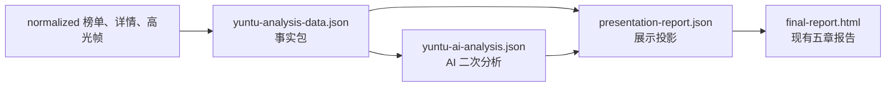

# 云图事实包与报告章节拆解

**分析对象：**

`RPA数据汇总/yuntu-rankings-analysis-20260730-20260805-food-beverage-brands-top6-strict`

**分析范围：** 当前报告的 01、02、04、05 四个章节。第 03 章当前只有“脚本数据未接入”占位，因此不纳入本次事实分析主链。

## 1. 总体链路



当前批次的规模：

- 行业榜单：1,000 条
- 成功秒级详情：5 条
- 失败详情：1 条
- 高光帧：29 张，其中封面帧 5 张、点击峰值帧 24 张
- AI 分析来源：`manual_model_generated`

## 2. 01｜TOP 素材组合结论

### 2.1 事实输入

主要事实来自 [yuntu-analysis-data.json](../RPA数据汇总/yuntu-rankings-analysis-20260730-20260805-food-beverage-brands-top6-strict/diagnostic-analysis/yuntu-analysis-data.json)：

| 字段 | 实际范围 | 内容 |
|---|---:|---|
| `industryTop1000Facts` | 1,000 条 | 行业 CTR、CVR、3 秒播放率、曝光及素材明细 |
| `brandTopNFacts` | 3 个品牌各 Top30 | 品牌样本指标、品牌素材明细、标题匹配归属 |
| `reportScopes.ranking` | 1,000 条 | 01 章范围声明 |

真实数据中的行业中位数：

- CTR：`0.0280`
- CVR：`0.0366`
- 3 秒播放率：`0.3152`
- CPM：不可用，原因是 RPA 未提供

品牌匹配规模和 Top30 范围：

- WONDERLAB/万益蓝：382 条匹配素材，取 Top30
- 五个女博士：265 条匹配素材，取 Top30
- 燕之屋：95 条匹配素材，取 Top30

### 2.2 AI 输入与输出

AI 输出字段为 `analysis.topMaterialCombination`，包含：

- `executiveSummary`
- `overallConclusions`
- `brandConclusions`
- `brandComparisonConclusion`

当前真实 AI JSON 同时生成了 `data`、`people`、`marketing` 三个维度的结论。

### 2.3 最终展示

当前 HTML 01 章展示：

1. 综合结论
2. TOP1000 整体分析
3. 三个品牌的 Top30 Tab
4. 品牌间差异总结

但由于当前渲染器在存在 `chapter02Facts` 时将 01 章收敛为数据维度，最终用户可见内容主要是：

- 行业指标基线
- 品牌指标对比
- 曝光、CTR、CVR、3 秒播放率的解释

AI 已生成的 01 章人群和营销内容目前不会在 01 章显示，而是由 02 章承载。

### 2.4 当前职责边界

```text
industryTop1000Facts / brandTopNFacts
  -> 01 章事实依据

analysis.topMaterialCombination
  -> 01 章可见业务结论

chapter02Facts / chapter02AiFacts
  -> 不应被 01 章用来补充结论
```

事实包中的 `topMaterialCombination` 是确定性汇总对象，但当前主 HTML 主要使用 AI 结果中的同名对象，二者存在重复职责，需要在后续优化时明确区分。

## 3. 02｜人群及营销卖点洞察

### 3.1 双事实源

02 章存在两套范围不同的事实：

| 范围 | `chapter02Facts` 图表数据 | `chapter02AiFacts` AI 数据 |
|---|---:|---:|
| 全量 TOP1000 | 1,000 条 | 1,000 条 |
| WONDERLAB/万益蓝 | 382 条 | 30 条 |
| 五个女博士 | 265 条 | 30 条 |
| 燕之屋 | 95 条 | 30 条 |

设计意图是：

```text
chapter02Facts
  -> 报告图表、营销标签统计、范围 Tab、TopN 控件

chapter02AiFacts
  -> AI 人群洞察和营销卖点洞察
```

### 3.2 最终展示

每个范围 Tab 当前包含：

- 2 条人群 AI 洞察
- 2 条营销 AI 洞察
- 年龄、性别、八大人群图表
- 营销卖点一级分类图
- 一级分类对应的二级标签展开
- TopN 控件

真实营销标签规模：

- 全量 TOP1000：1,399 个标签、5,825 次命中
- 万益蓝：716 个标签、2,039 次命中
- 五个女博士：490 个标签、1,771 次命中
- 燕之屋：141 个标签、390 次命中

因此页面采用“一级分类 -> 二级标签明细”的展示方式，没有逐条铺开全部标签。

### 3.3 AI 结构兼容

当前真实 AI 文件仍使用旧式结构：

```json
{
  "audienceAnalysis": {
    "overallSummary": "...",
    "insights": []
  },
  "marketingAnalysis": {
    "overallSummary": "...",
    "insights": []
  }
}
```

报告入口会将其转换为当前使用的 `chapter02Insights` 结构，再交给 Presentation 和 HTML 渲染器。

因此 02 章实际存在：

```text
AI 原始 JSON
  -> report 兼容转换
  -> chapter02Insights
  -> presentation chapter02
  -> HTML
```

后续调整 02 章内容时，必须先决定修改 AI 原始结构、兼容转换，还是最终展示投影。

## 4. 04｜高光画面洞察

### 4.1 事实输入

主要事实来自：

- `highlightFrameFacts`
- `visualAssets`
- `materialFacts[].highlightFrames`

真实批次有：

- 29 张可用高光帧
- 5 张封面帧
- 24 张点击指数局部峰值帧
- 所有成功帧都带有 `frame_ref`、秒数、峰值排名、点击指数值和本地图片路径

高光帧并不是 AI 选出来的。候选帧由固定规则选取：

```text
0 秒封面
  + 点击指数局部峰值 Top5
  -> 下载视频并截帧
  -> 写入 highlights-manifest.json
```

### 4.2 AI 输入与输出

AI 需要实际查看每张 `available=true` 的本地 JPEG，然后生成 `highlightDashboard`。

`highlightDashboard` 当前包含：

- `category`
- `frame_refs`
- `common_patterns`
- `derivative_directions`

当前真实批次只使用两个分类：

| 分类 | 帧数 | 共性洞察 | 裂变方向 |
|---|---:|---:|---:|
| `product` | 23 | 1 条 | 2 条 |
| `text_overlay` | 6 | 1 条 | 2 条 |

虽然契约允许 `portrait`、`scene`、`other`，但真实 AI 结果中没有非空分类，因此最终报告只显示“产品画面”和“字幕画面”。

### 4.3 最终展示

04 章当前展示：

1. 数据范围标签：成功秒级拆解素材 5 条
2. 高光帧选择规则说明
3. 视觉分类 Tab
4. 每类帧的共同洞察
5. 每类帧的裂变方向
6. 高光帧分页网格
7. 点击图片后查看大图
8. 点击“查看素材”跳转到 05 章对应素材

### 4.4 当前职责边界

```text
highlightFrameFacts / visualAssets
  -> 帧是否存在、帧发生在哪一秒、图片路径和点击峰值信息

highlightDashboard
  -> AI 对画面进行的分类、观察和方向提炼

render_highlight_insights
  -> 将分类、帧和方向排版成 04 章
```

AI 不允许将高光帧描述为导致点击、转化或指标提升，也不能把帧与脚本台词建立未经数据支持的对应关系。

## 5. 05｜单素材深度分析

### 5.1 事实输入

主要事实来自：

- `materialFacts`
- `secondLevelFacts`
- `materialFacts[].highlightFrames`
- `selectedMaterials`

真实批次有 5 个成功详情素材，每个素材都有：

- 5 或 6 张高光帧
- 5 个秒级指标
- 每个指标的完整秒级点序列
- 高点与流失点
- 5 条高光帧观察
- 5 条秒级观察

五类秒级指标固定为：

```text
点赞指数
流失指数
点击指数
互动指数
评论指数
```

真实批次中每条素材的每个指标均有完整点序列；第一条素材为 65 个点，第二和第三条为 65/74 个点，其他素材按视频长度不同而变化。

### 5.2 AI 输入与输出

AI 输出 `materialDeepDives`，每个成功素材一项，包含：

- `material_id`
- `frame_observations`
- `second_level_observations`

当前真实批次每条素材都有：

- 每张可用高光帧恰好一次观察
- 五个趋势各一条秒级观察
- 每条秒级观察引用真实存在的秒数

AI 不允许在 `materialDeepDives` 中额外生成不受事实约束的素材总结，也不允许补写脚本、内容公式、真实互动量、转化结论或因果关系。

### 5.3 最终展示

05 章当前展示：

1. 左侧 5 个素材 Tab
2. 当前素材的排名、标题、素材 ID
3. 曝光、CTR、CVR、3 秒播放率、互动率
4. 人群标签和营销卖点标签
5. 三个内部视图 Tab：
   - 高光帧观察
   - 秒级拆解
   - 脚本分析
6. 高光帧网格和单帧观察
7. 五类指标的可切换时间线
8. 高点、流失点和秒级观察

当前脚本分析 Tab 仍因 RPA 返回脚本字段为空而显示不可用状态。

### 5.4 当前职责边界

```text
materialFacts
  -> 素材基础指标、标签、帧事实、秒级事实

materialDeepDives
  -> AI 对单帧和秒级趋势的解释

presentation chapter05
  -> 将事实和 AI 观察绑定到具体素材 Tab

HTML/JS
  -> 素材 Tab、帧选择、趋势切换、时间线交互
```

## 6. 四章统一映射

| 章节 | 确定性事实主源 | AI 主源 | 最终展示主体 | 当前主要边界 |
|---|---|---|---|---|
| 01 | `industryTop1000Facts`、`brandTopNFacts` | `topMaterialCombination` | 行业整体、品牌 Tab、品牌差异 | 不使用秒级详情；当前只展示数据维度 |
| 02 | `chapter02Facts` | `chapter02Insights`，输入为 `chapter02AiFacts` | 人群/营销 Tab、图表、AI 卡片 | 图表全量，品牌 AI Top30 |
| 04 | `highlightFrameFacts`、`visualAssets` | `highlightDashboard` | 视觉分类、帧网格、裂变方向 | 每帧只能分类一次；只描述点击峰值画面 |
| 05 | `materialFacts`、`secondLevelFacts` | `materialDeepDives` | 素材 Tab、帧观察、五类趋势 | 只覆盖成功详情；脚本字段当前不可用 |

## 7. 后续调整最终报告时的定位方法

后续任何内容调整，都先判断属于哪一层：

```text
事实不够或范围不对
  -> 调整 yuntu_analysis.py 的事实包生成

事实正确，但 AI 结论不符合业务要求
  -> 调整 yuntu-analysis-prompt.md 的生成规则或 AI JSON 契约

AI 结论正确，但不想在当前章节显示
  -> 调整 yuntu_report.py / yuntu_report_sections.py 的展示投影

内容正确，但页面交互或布局不符合要求
  -> 调整 yuntu_presentation.py、HTML 模板、CSS 或 JS
```

四章的稳定原则是：

1. 事实包负责真实范围、指标、标签、趋势和图片引用。
2. AI 负责解释、归纳、观察和测试方向。
3. Presentation 负责把事实和 AI 结果投影成稳定的章节数据。
4. HTML/CSS/JS 负责呈现和交互，不新增业务结论。

## 8. 当前最重要的结构观察

当前事实包里同时存在新旧并行字段，例如：

- `topMaterialCombination` 与 `brandTopNFacts`
- `audienceDashboard` 与 `chapter02Facts`
- `audienceAnalysis`/`marketingAnalysis` 与 `chapter02Insights`
- `materialFacts` 与 `secondLevelFacts`

它们目前通过兼容逻辑共同工作，但后续优化报告内容时必须先明确：

```text
哪些字段是唯一事实源
哪些字段只是 AI 输入投影
哪些字段只是旧报告兼容
哪些字段是最终展示专用
```

这份拆解不改变当前报告结构；它为下一步的事实包、AI 二次分析和最终报告内容调整提供字段级基线。
